# ETL Vuelos — Modelo Multidimensional en SQL Server

> **Práctica 1 · Sistemas de Soporte a la Toma de Decisiones**  
> Grupo SS22S2026_G1

---

## Tabla de contenidos

- [1. Descripción del proyecto](#1-descripci%C3%B3n-del-proyecto)
- [2. Análisis del dataset real y ajustes al modelo](#2-an%C3%A1lisis-del-dataset-real-y-ajustes-al-modelo)
  - [2.1 Hallazgos del dataset (dataset_vuelos_crudo.csv)](#21-hallazgos-del-dataset-dataset_vuelos_crudocsv)
  - [2.2 Adaptaciones al modelo propuesto](#22-adaptaciones-al-modelo-propuesto)
- [3. Arquitectura del sistema (Diagrama de flujo)](#3-arquitectura-del-sistema-diagrama-de-flujo)
- [4. Diseño del modelo dimensional](#4-dise%C3%B1o-del-modelo-dimensional)
  - [Diagrama del modelo estrella](#diagrama-del-modelo-estrella)
  - [Descripción del grano](#descripci%C3%B3n-del-grano)
  - [Tablas de dimensión](#tablas-de-dimensi%C3%B3n)
  - [Tabla de hechos](#tabla-de-hechos)
- [5. Stack tecnológico](#5-stack-tecnol%C3%B3gico)
- [6. Estructura del repositorio](#6-estructura-del-repositorio)
- [7. Instalación y ejecución (Entorno Contenerizado)](#7-instalaci%C3%B3n-y-ejecuci%C3%B3n-entorno-contenerizado)
  - [Requisitos previos](#requisitos-previos)
  - [Paso 1 — Clonar el repositorio](#paso-1--clonar-el-repositorio)
  - [Paso 2 — Configurar variables de entorno](#paso-2--configurar-variables-de-entorno)
  - [Paso 3 — Levantar la Base de Datos SQL Server](#paso-3--levantar-la-base-de-datos-sql-server)
  - [Paso 4 — Ejecutar el Pipeline ETL en Python (Contenerizado)](#paso-4--ejecutar-el-pipeline-etl-en-python-contenerizado)
  - [Paso 5 — Verificar la carga de datos en la Base de Datos](#paso-5--verificar-la-carga-de-datos-en-la-base-de-datos)
  - [Paso 6 — Ejecutar las consultas analíticas](#paso-6--ejecutar-las-consultas-anal%C3%ADticas)
  - [Reiniciar todo desde cero](#reiniciar-todo-desde-cero)
- [8. Reglas de transformación aplicadas](#8-reglas-de-transformaci%C3%B3n-aplicadas)
- [9. Consultas analíticas](#9-consultas-anal%C3%ADticas)
- [10. Resultados Obtenidos](#10-resultados-obtenidos)
  - [10.1 Consulta 1: Conteo por tabla](#101-consulta-1-conteo-por-tabla)
  - [10.2 Consulta 2: Top 5 destinos más frecuentes](#102-consulta-2-top-5-destinos-m%C3%A1s-frecuentes)
  - [10.3 Consulta 3: Distribución por género](#103-consulta-3-distribuci%C3%B3n-por-g%C3%A9nero)
  - [10.4 Consulta 4: Vuelos por mes/año](#104-consulta-4-vuelos-por-mesa%C3%B1o)
  - [10.5 Consulta 5: Aerolíneas por volumen (Top 10)](#105-consulta-5-aerol%C3%ADneas-por-volumen-top-10)
  - [10.6 Consulta 6: Retraso promedio por estado de vuelo](#106-consulta-6-retraso-promedio-por-estado-de-vuelo)
  - [10.7 Consulta 7: Precio promedio por ruta (Top 20)](#107-consulta-7-precio-promedio-por-ruta-top-20)
  - [10.8 Consulta 8: Precio por aerolínea y clase de cabina](#108-consulta-8-precio-por-aerol%C3%ADnea-y-clase-de-cabina)
  - [10.9 Consulta 9: Tasa de cancelación por aerolínea](#109-consulta-9-tasa-de-cancelaci%C3%B3n-por-aerol%C3%ADnea)
  - [10.10 Consulta 10: Distribución rango etario × clase](#1010-consulta-10-distribuci%C3%B3n-rango-etario--clase)

---

## 1. Descripción del proyecto

Este proyecto implementa un **pipeline ETL completo** en Python que:

1. **Extrae** un dataset crudo de ~10 000 registros de vuelos (CSV con 26 columnas y múltiples problemas de calidad).
2. **Transforma** los datos: limpieza, homologación, tipado correcto, y construcción de un **esquema estrella** con 6 dimensiones y una tabla de hechos.
3. **Carga** el modelo en **SQL Server 2022** corriendo en Docker.
4. Permite **consultas analíticas** de BI (rutas populares, distribución por género, volumen temporal, ranking de aerolíneas, precios, etc.).

El sistema es **modular**, **trazable** (logging a archivo y consola), **idempotente** (re-ejecución sin duplicados) y **reproducible** (levantable desde cero con Docker + venv).

---

## 2. Análisis del dataset real y ajustes al modelo

### 2.1 Hallazgos del dataset (`dataset_vuelos_crudo.csv`)

| Dimensión | Detalle |
|---|---|
| Filas | 10 000 |
| Columnas | 26 |
| Vuelos cancelados | ~560 (arrival_datetime, duration_min y delay_min nulos) |
| Formatos de fecha | Múltiples: `DD/MM/YYYY HH:MM`, `MM-DD-YYYY HH:MM AM/PM` |
| Variantes de género | 12 variantes (M, m, Masculino, masculino, F, f, Femenino, femenino, X, x, NoBinario, nobinario) |
| Variantes de aerolínea | 23 strings para solo 12 aerolíneas (capitalización inconsistente) |
| Aeropuertos en minúscula | Ej: `jfk` → normalizar a `JFK` |
| Precio con coma decimal | Ej: `77,60` → parsear correctamente |
| Monedas | 4 (USD, EUR, GTQ, MXN) → se usa `ticket_price_usd_est` |
| Estados de vuelo | 4: ON_TIME, CANCELLED, DELAYED, DIVERTED |

### 2.2 Adaptaciones al modelo propuesto

El modelo es el punto de partida. Los siguientes ajustes se hicieron al encontrar el dataset real:

| Cambio | Justificación |
|---|---|
| **`DimAeropuerto` enriquecida** | Los códigos IATA fueron enriquecidos con nombre oficial del aeropuerto, ciudad y país para habilitar jerarquías geográficas y análisis espacial. |
| **`DimClase` (nueva)** | `cabin_class` y `aircraft_type` están en el CSV y agregan valor analítico. Se crea dimensión separada en lugar de atributo degenerado. |
| **`DimEstado` (nueva)** | 4 estados de vuelo distintos (ON_TIME / CANCELLED / DELAYED / DIVERTED) ameritan dimensión para filtros eficientes. |
| **Métricas operativas** | `retraso_minutos`, `total_equipaje` y `dias_anticipacion` (lead time de reserva) calculadas y almacenadas en FactVuelos. |
| **Atributos degenerados** | `canal_venta` y `metodo_pago` se conservan en FactVuelos (cardinalidad baja, no amerita dimensión propia). |

---

## 3. Arquitectura del sistema (Diagrama de flujo)

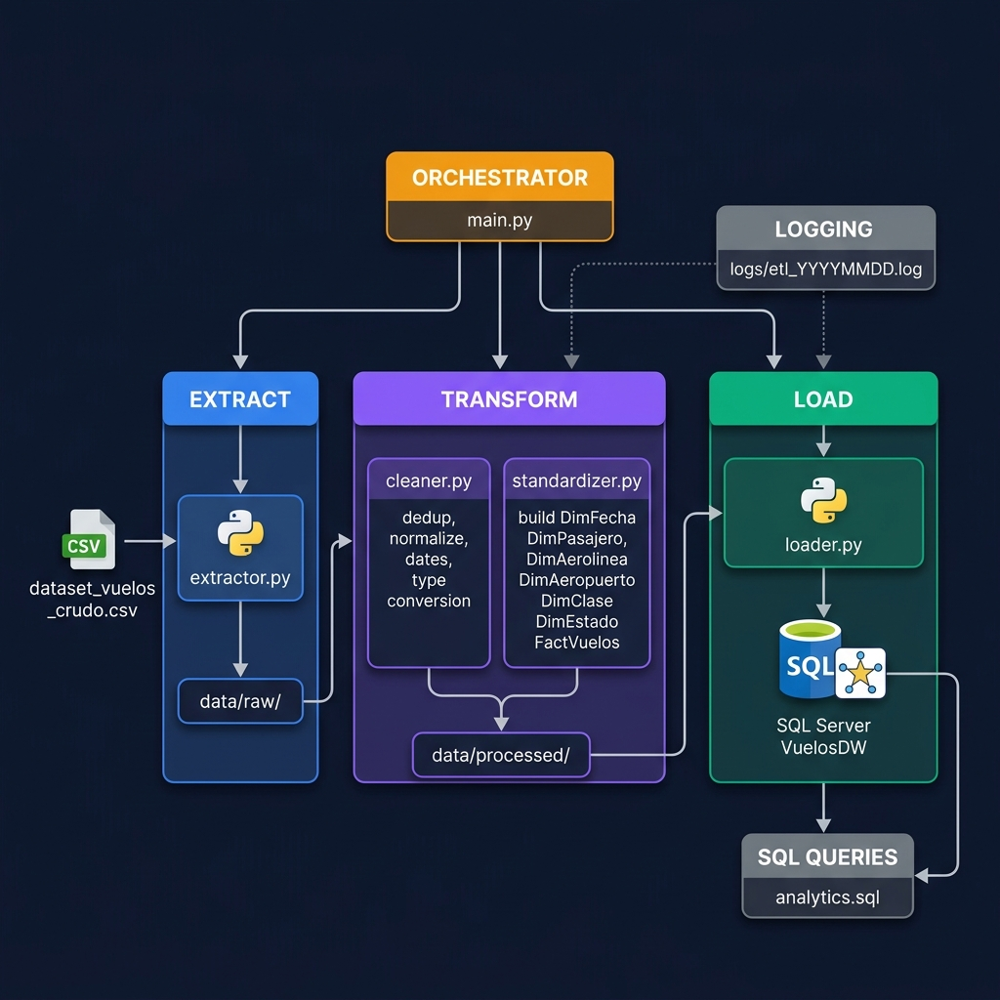

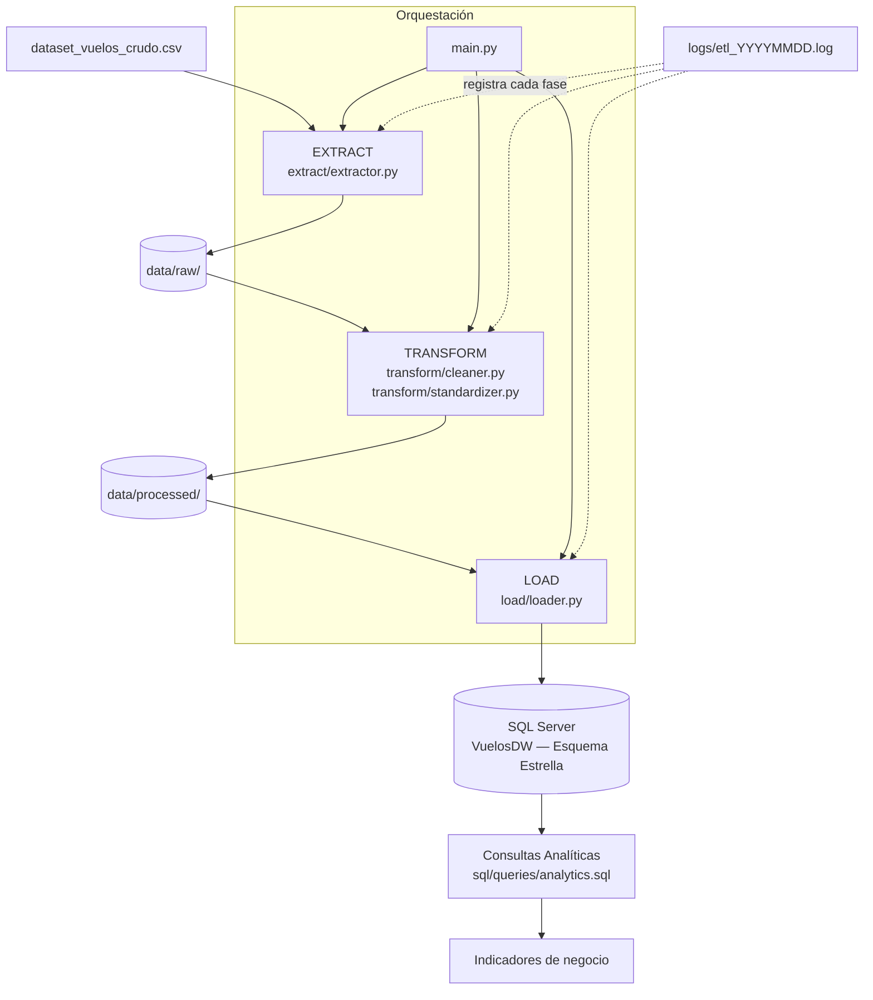

**Flujo paso a paso:**

1. **Extract**: `main.py` invoca `extract/extractor.py`, que lee el CSV, valida el esquema mínimo y guarda un snapshot con timestamp en `data/raw/`.
2. **Transform (Limpieza)**: `transform/cleaner.py` elimina duplicados, normaliza texto, homologa géneros (12 variantes → M/F/OTRO), parsea fechas en múltiples formatos, convierte tipos y rechaza filas inválidas con log.
3. **Transform (Estandarización)**: `transform/standardizer.py` construye los 6 DataFrames de dimensión y `FactVuelos` con llaves subrogadas y FK resueltas.
4. **Load**: `load/loader.py` crea la BD si no existe, ejecuta el DDL, y carga en orden (dimensiones → hechos) con TRUNCATE + INSERT (idempotente).
5. **Logging**: cada fase escribe al mismo archivo `logs/etl_YYYYMMDD.log` y a consola con nivel configurable.

---

## 4. Diseño del modelo dimensional

### Diagrama del modelo estrella

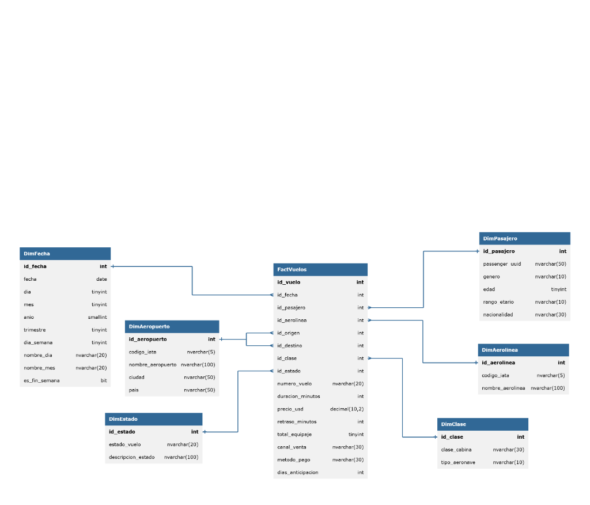

### Descripción del grano

**Un registro por vuelo reservado/realizado.** Cada fila de `FactVuelos` corresponde a un vuelo único (identificado por `numero_vuelo` como atributo degenerado) con su pasajero asociado.

### Tablas de dimensión

| Tabla | PK | Columnas clave | Descripción |
|---|---|---|---|
| **DimFecha** | `id_fecha` | fecha, dia, mes, anio, trimestre, dia_semana, es_fin_semana | Calendario de fechas de salida |
| **DimPasajero** | `id_pasajero` | passenger_uuid, genero, edad, rango_etario, nacionalidad | Perfil del pasajero |
| **DimAerolinea** | `id_aerolinea` | codigo_iata, nombre_aerolinea | Aerolínea operadora |
| **DimAeropuerto** | `id_aeropuerto` | codigo_iata, nombre_aeropuerto, ciudad, pais | Aeropuertos enriquecidos (rol-playing: origen y destino) |
| **DimClase** | `id_clase` | clase_cabina, tipo_aeronave | Clase de cabina × tipo de aeronave |
| **DimEstado** | `id_estado` | estado_vuelo, descripcion_estado | Estado del vuelo (ON_TIME/CANCELLED/DELAYED/DIVERTED) |

### Tabla de hechos

| Columna | Tipo | Descripción |
|---|---|---|
| `id_vuelo` | INT IDENTITY | PK surrogate |
| `id_fecha` | INT FK | → DimFecha |
| `id_pasajero` | INT FK | → DimPasajero |
| `id_aerolinea` | INT FK | → DimAerolinea |
| `id_origen` | INT FK | → DimAeropuerto (rol: origen) |
| `id_destino` | INT FK | → DimAeropuerto (rol: destino) |
| `id_clase` | INT FK | → DimClase |
| `id_estado` | INT FK | → DimEstado |
| `numero_vuelo` | VARCHAR | Atributo degenerado |
| `duracion_minutos` | INT | Métrica |
| `precio_usd` | DECIMAL(10,2) | Métrica |
| `retraso_minutos` | INT | Métrica |
| `total_equipaje` | TINYINT | Métrica |
| `canal_venta` | VARCHAR | Atributo degenerado |
| `metodo_pago` | VARCHAR | Atributo degenerado |
| `dias_anticipacion` | INT | Métrica (días entre reserva y salida) |

---

## 5. Stack tecnológico

| Elemento | Especificación |
|---|---|
| Lenguaje | Python 3.10+ |
| BD | Microsoft SQL Server 2022 (Docker) |
| ORM / Conexión | SQLAlchemy 2.0 + pyodbc |
| Manipulación datos | pandas 2.0 |
| Configuración | python-dotenv |
| Contenedor | Docker + docker-compose |
| Testing | pytest |

---

## 6. Estructura del repositorio

```
SS22S2026_G1/
└── Practica1/
    ├── README.md                    ← Este archivo
    ├── requirements.txt
    ├── .env.example                 ← Plantilla de variables de entorno
    ├── .gitignore
    ├── docker-compose.yml           ← SQL Server 2022 en Docker
    ├── main.py                      ← Orquestador del ETL
    ├── config/
    │   └── settings.py              ← Carga .env y construye connection strings
    ├── extract/
    │   └── extractor.py             ← Lectura y validación del CSV
    ├── transform/
    │   ├── cleaner.py               ← Limpieza y homologación
    │   └── standardizer.py          ← Construcción de dimensiones y hechos
    ├── load/
    │   └── loader.py                ← Carga a SQL Server (dims → hechos)
    ├── sql/
    │   ├── ddl/
    │   │   └── create_model.sql     ← DDL del esquema estrella
    │   └── queries/
    │       └── analytics.sql        ← 10 consultas analíticas
    ├── data/
    │   ├── raw/                     ← Snapshots del CSV original (trazabilidad)
    │   └── processed/               ← CSV limpio pre-carga (debug)
    ├── img/
    │   ├── diagrama_flujo.png
    │   ├── modelo_dimensional.png
    │   ├── consulta1.png
    │   ├── consulta2.png
    │   ├── consulta3.png
    │   ├── consulta4.png
    │   ├── consulta5.png
    │   ├── consulta6.png
    │   ├── consulta7.png
    │   ├── consulta8.png
    │   ├── consulta9.png
    │   └── consulta10.png
    ├── logs/
    │   └── etl_YYYYMMDD.log         ← Generado automáticamente
    └── tests/
        └── test_transform.py        ← Pruebas unitarias
```

---

## 7. Instalación y ejecución (Entorno Contenerizado)

### Requisitos previos

- Docker Engine / Docker Desktop y Docker Compose

---

### Paso 1 — Clonar el repositorio

```bash
git clone <URL_DEL_REPO>
cd SS22S2026_G1/Practica1
```

---

### Paso 2 — Configurar variables de entorno

```bash
cp .env.example .env
```

Editar `.env` si se requiere modificar credenciales:

```env
DB_SERVER=sqlserver,1433
DB_NAME=VuelosDW
DB_USER=sa
DB_PASSWORD=TuPasswordSegura123!
DB_DRIVER=ODBC Driver 18 for SQL Server
RAW_DATA_PATH=dataset_vuelos_crudo.csv
LOG_LEVEL=INFO
```

> **Nunca subas el archivo `.env` al repositorio.** Está en `.gitignore`.

---

### Paso 3 — Levantar la Base de Datos SQL Server

```bash
docker compose up -d sqlserver
```

Verificar que el contenedor esté en estado saludable (`healthy`):

```bash
docker compose ps
```
> Debe mostrar: ss2_sqlserver   Up (healthy)

---

### Paso 4 — Ejecutar el Pipeline ETL en Python (Contenerizado)

Para ejecutar el proceso ETL sin instalar Python ni controladores localmente:

```bash
docker compose run --rm etl
```

El proceso realiza automáticamente:
1. Lee `dataset_vuelos_crudo.csv` dentro del contenedor.
2. Limpia y transforma los datos.
3. Crea la base de datos `VuelosDW` y el esquema estrella en SQL Server.
4. Carga todas las tablas del modelo.

Los registros de auditoría se guardan localmente en `logs/etl_YYYYMMDD.log` a través de volúmenes de Docker.

---

### Paso 5 — Verificar la carga de datos en la Base de Datos

Puedes verificar que las tablas se poblaron correctamente ejecutando la consulta de conteo con `sqlcmd` directamente desde el contenedor de SQL Server:

```bash
docker exec -it ss2_sqlserver /opt/mssql-tools18/bin/sqlcmd \
  -S localhost -U sa -P "S2P1G1!2026" -C \
  -Q "USE VuelosDW; SELECT 'DimFecha' AS Tabla, COUNT(*) AS Total FROM dbo.DimFecha UNION ALL SELECT 'DimPasajero', COUNT(*) FROM dbo.DimPasajero UNION ALL SELECT 'DimAerolinea', COUNT(*) FROM dbo.DimAerolinea UNION ALL SELECT 'DimAeropuerto', COUNT(*) FROM dbo.DimAeropuerto UNION ALL SELECT 'DimClase', COUNT(*) FROM dbo.DimClase UNION ALL SELECT 'DimEstado', COUNT(*) FROM dbo.DimEstado UNION ALL SELECT 'FactVuelos', COUNT(*) FROM dbo.FactVuelos;"
```

---

### Paso 6 — Ejecutar las consultas analíticas

Conectarse a SQL Server desde el host o cliente SQL (DBeaver, Azure Data Studio, SSMS):

| Campo | Valor |
|---|---|
| Servidor | `localhost,1433` |
| Usuario | `sa` |
| Contraseña | La definida en `.env` (`S2P1G1!2026`) |
| Base de datos | `VuelosDW` |

Luego ejecutar `sql/queries/analytics.sql`.

---

### Reiniciar todo desde cero

```bash
# Detener contenedores y eliminar volúmenes
docker compose down -v

# Volver a levantar BD y ejecutar ETL
docker compose up -d sqlserver
docker compose run --rm etl
```

---

## 8. Reglas de transformación aplicadas

| Regla | Implementación |
|---|---|
| Eliminar duplicados exactos | `df.drop_duplicates()` en `cleaner.py` |
| Normalizar texto (trim + uppercase) | Aeropuertos, status, clase, canal, moneda |
| Homologar género | 12 variantes → M / F / OTRO (`GENDER_MAP` dict) |
| Homologar nombre aerolínea | 23 strings → 12 nombres canónicos (Title Case) |
| Parseo de fechas múltiples formatos | `DD/MM/YYYY HH:MM`, `MM-DD-YYYY HH:MM AM/PM`, ISO 8601, etc. |
| Convertir precio con coma decimal | `77,60` → `77.60` |
| Usar precio USD estimado | Se usa `ticket_price_usd_est` (multi-moneda ya convertida) |
| Rellenar nulos en vuelos cancelados | `duration_min=0`, `delay_min=0` |
| Calcular `rango_etario` | Bins: <18, 18-25, 26-35, 36-50, 51-65, 65+ |
| Registrar rechazos en log | Motivo + conteo en `logs/etl_YYYYMMDD.log` |
| Validar FK antes de cargar | Filas con FK nulas excluidas de FactVuelos |

---

## 9. Consultas analíticas

El archivo `sql/queries/analytics.sql` incluye las 10 consultas siguientes:

| # | Consulta | Indicador |
|---|---|---|
| 1 | Conteo por tabla | Validación de carga completa |
| 2 | Top 5 destinos más frecuentes | (excluye CANCELLED) |
| 3 | Distribución por género | Pasajeros únicos + vuelos |
| 4 | Vuelos por mes/año | Volumen temporal + ingresos |
| 5 | Aerolíneas por volumen (Top 10) | Con ingresos y cancelaciones |
| 6 | Retraso promedio por estado de vuelo | Promedio y máximo |
| 7 | Precio promedio por ruta (Top 20) | Min/Avg/Max USD |
| 8 | Precio por aerolínea y clase de cabina | Análisis cruzado |
| 9 | Tasa de cancelación por aerolínea | Porcentaje de cancelados |
| 10 | Distribución rango etario × clase | Perfil de pasajero |

---

## 10. Resultados Obtenidos

A continuación se presentan los resultados obtenidos al ejecutar las 10 consultas analíticas especificadas en el archivo `sql/queries/analytics.sql`:

### 10.1 Consulta 1: Conteo por tabla
Esta consulta realiza un conteo del total de registros cargados en cada una de las tablas de dimensiones y en la tabla de hechos para verificar la consistencia del proceso de carga completa.
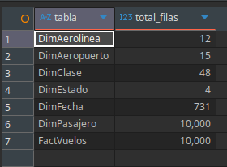

### 10.2 Consulta 2: Top 5 destinos más frecuentes
Muestra los 5 aeropuertos de destino más populares (código IATA) basándose en el volumen total de vuelos (excluyendo vuelos cancelados).
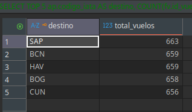

### 10.3 Consulta 3: Distribución por género
Analiza la cantidad de pasajeros únicos y el número total de vuelos realizados por cada género registrado (M, F, OTRO).
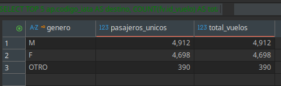

### 10.4 Consulta 4: Vuelos por mes/año
Presenta un histórico mensual del volumen de vuelos y los ingresos totales acumulados, permitiendo identificar la evolución del negocio a lo largo del tiempo.
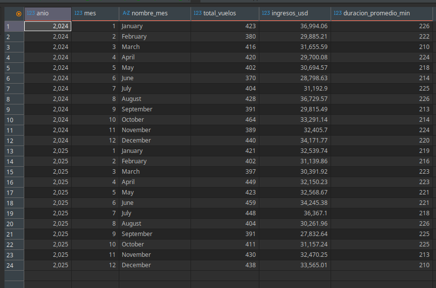

### 10.5 Consulta 5: Aerolíneas por volumen (Top 10)
Lista el Top 10 de aerolíneas con mayor volumen de vuelos operados, desglosando sus ingresos totales generados y la cantidad de vuelos cancelados asociados.
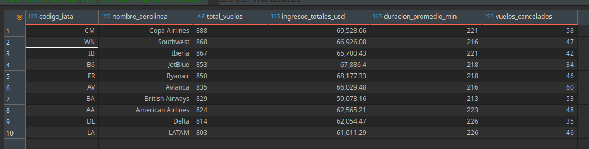

### 10.6 Consulta 6: Retraso promedio por estado de vuelo
Calcula el promedio y el retraso máximo registrado en minutos para cada uno de los estados de vuelo posibles.
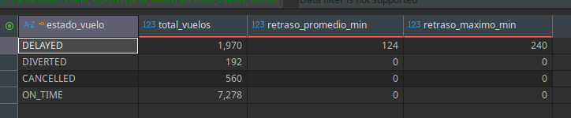

### 10.7 Consulta 7: Precio promedio por ruta (Top 20)
Identifica las 20 rutas aéreas (aeropuerto de origen a aeropuerto de destino) con mayor facturación promedio, mostrando además los límites mínimo y máximo de precio en USD.
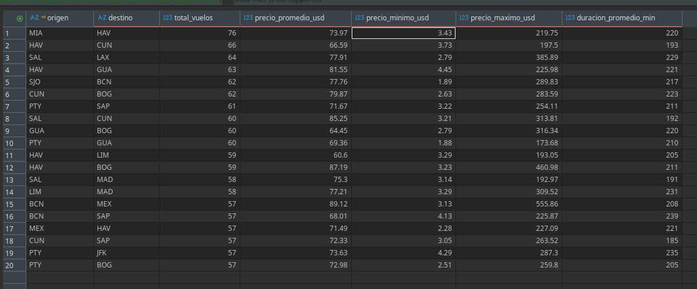

### 10.8 Consulta 8: Precio por aerolínea y clase de cabina
Realiza un cruce dimensional para evaluar los costos promedio y totales por tipo de boleto (clase y tipo de avión) para cada aerolínea.
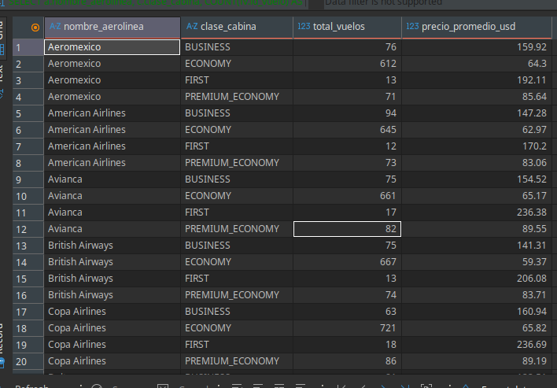

### 10.9 Consulta 9: Tasa de cancelación por aerolínea
Determina el porcentaje de vuelos cancelados para cada una de las aerolíneas con el fin de medir la tasa de cancelación general.
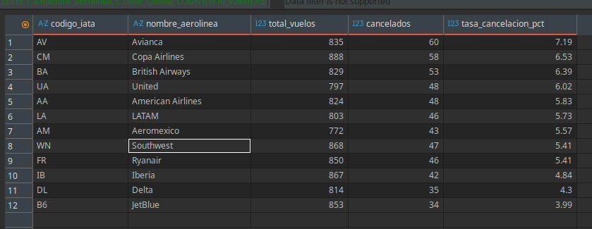

### 10.10 Consulta 10: Distribución rango etario × clase
Muestra el perfil demográfico de los viajeros mediante el cruce de los distintos rangos de edad con el tipo de clase en el que viajaron.
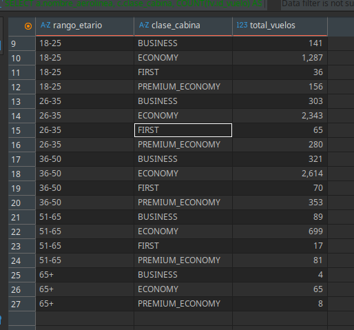