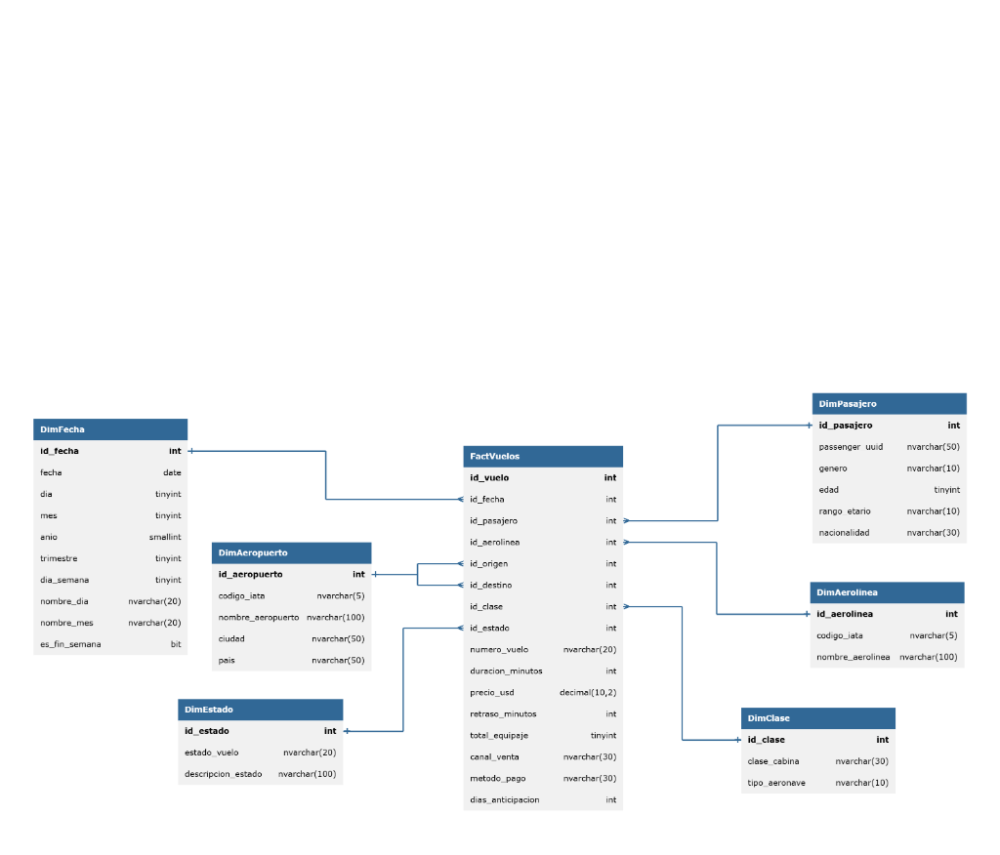
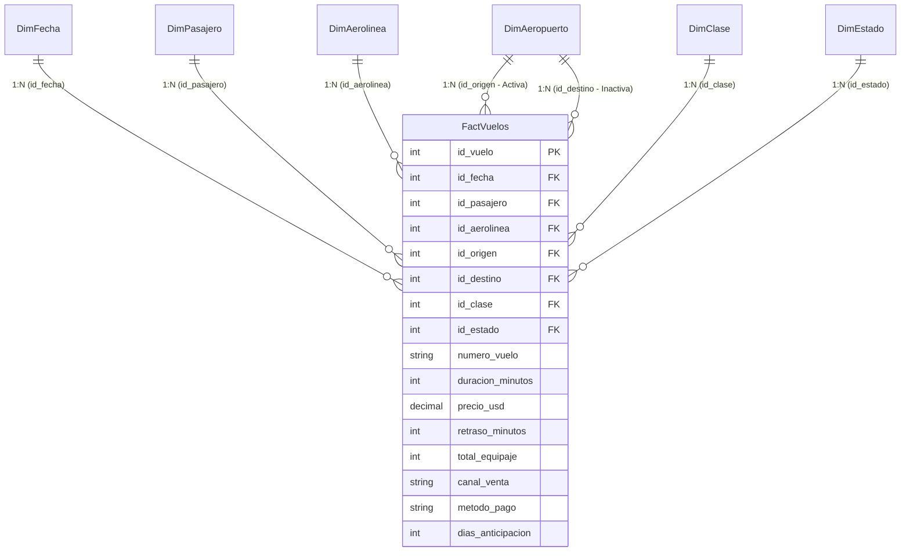
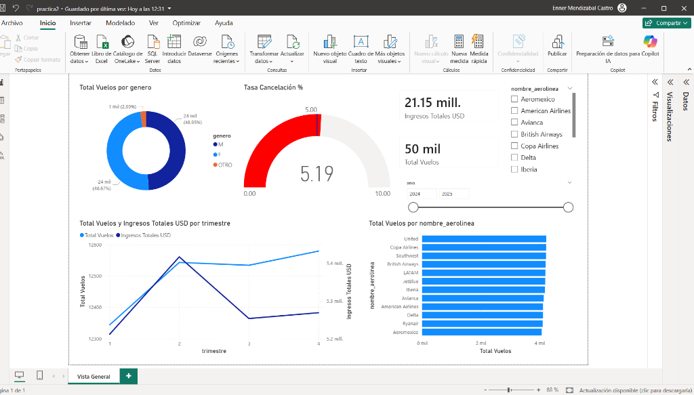
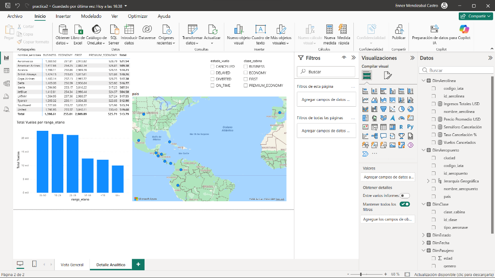

# Seminario de Sistemas 2 — Práctica 2
## Dashboard Ejecutivo y Analítico en Power BI sobre VuelosDW (.pbix)

---

### Información General
- **Curso:** Seminario de Sistemas 2
- **Ciclo:** Primer Semestre 2026
- **Grupo:** 1
- **Fuente de Datos:** SQL Server 2022 (Data Warehouse `VuelosDW` — Esquema Estrella)
- **Herramienta de Business Intelligence:** Microsoft Power BI Desktop
- **Entregable Principal:** Archivo de Power BI (`VuelosDW.pbix`)

---

## 1. Introducción y Objetivos

El presente proyecto corresponde al desarrollo de la **Práctica 2** del curso Seminario de Sistemas 2. El propósito central es transformar los datos almacenados en el Data Warehouse `VuelosDW` (generado durante la Práctica 1) en información accionable para la alta dirección y gerencias operativas de una red de transporte aéreo.

### Objetivos Estratégicos
1. **Conexión Directa y Automatizada:** Establecer una conexión robusta entre Power BI Desktop y el motor relacional SQL Server ejecutado en contenedores Docker.
2. **Modelado Tabular de Alto Rendimiento:** Implementar un modelo dimensional con relaciones de integridad referencial (1:N), jerarquías de fecha navegables y granularidad a nivel de boleto/vuelo emitido.
3. **Cálculo de Indicadores Clave (KPIs) con DAX:** Desarrollar medidas analíticas estándar y avanzadas (Time Intelligence, agregaciones condicionales, tasas porcentuales y semáforos de desempeño).
4. **Diseño de Dashboard Interactivo:** Construir una solución visual de dos páginas ("Vista General" y "Detalle Analítico") que permita el análisis descriptivo y de tendencias mediante filtrado cruzado (*cross-filtering*) y segmentadores dedicados.
5. **Calidad e Integridad de Datos:** Garantizar la consistencia en el manejo de nulos e integridad referencial en todas las dimensiones y hechos.

---

## 2. Arquitectura de la Solución

El ecosistema de la práctica está diseñado para ser **completamente reproducible y desacoplado**:

```
┌─────────────────────────────────────────────────────────┐
│                    Host (Windows)                       │
│                                                         │
│   ┌───────────────────────────────────────────────┐     │
│   │         Microsoft Power BI Desktop            │     │
│   │                                               │     │
│   │               [VuelosDW.pbix]                 │     │
│   │                                               │     │
│   │   - Modelo Tabular (7 tablas, 1:N)            │     │
│   │   - Jerarquía Temporal (Año > Trim > Mes > Día)│    │
│   │   - Medidas DAX y Semáforo KPI                │     │
│   │   - Dashboard Ejecutivo (2 Páginas)           │     │
│   └──────────────────────┬────────────────────────┘     │
│                          │ TCP localhost:1433           │
└──────────────────────────┼──────────────────────────────┘
                           ▼
┌─────────────────────────────────────────────────────────┐
│              Docker Engine (Red Interna)                │
│                                                         │
│   ┌────────────────────────┐   ┌────────────────────┐   │
│   │ sqlserver (Puerto 1433)│◄──┤ etl (Python 3.10)  │   │
│   │  - SQL Server 2022     │   │  - Extract (CSV)   │   │
│   │  - Base: VuelosDW      │   │  - Transform       │   │
│   │  - Volumen persistente │   │  - Load (Bulk SQL) │   │
│   └────────────────────────┘   └────────────────────┘   │
└─────────────────────────────────────────────────────────┘
```

---

## 3. Modelo Tabular y Esquema Dimensional

### 3.1 Esquema Estrella (`VuelosDW`)

El modelo semántico adopta una arquitectura en estrella (*Star Schema*), optimizada para el motor analítico VertiPaq de Power BI:

- **1 Tabla de Hechos:** `FactVuelos` (100,000 registros de transacciones aéreas que abarcan de 2022 a 2026).
- **6 Tablas de Dimensiones:**
  - `DimFecha`: Dimensión de tiempo con calendario completo (1,704 días entre 2022 y 2026).
  - `DimPasajero`: Dimensión demográfica (género, nacionalidad, rango etario).
  - `DimAerolinea`: Dimensión organizacional de transportistas.
  - `DimAeropuerto`: Dimensión geográfica enriquecida (código IATA, nombre oficial, ciudad y país).
  - `DimClase`: Dimensión de cabina y tipo de aeronave.
  - `DimEstado`: Dimensión transaccional del estatus del vuelo (`ON_TIME`, `CANCELLED`, `DELAYED`, `DIVERTED`).

### Diagrama del Modelo Dimensional (Esquema Estrella)





### 3.2 Relaciones del Modelo Tabular

Todas las relaciones están tipadas como **Muchos a Uno (N:1)** desde `FactVuelos` hacia las dimensiones, con dirección de filtro cruzado único (*single direction*):

| Origen (FK) | Destino (PK) | Cardinalidad | Estado | Justificación |
|---|---|:---:|:---:|---|
| `FactVuelos[id_fecha]` | `DimFecha[id_fecha]` | N:1 | **Activa** | Filtrado temporal por fecha de salida del vuelo. |
| `FactVuelos[id_pasajero]` | `DimPasajero[id_pasajero]` | N:1 | **Activa** | Segmentación demográfica y análisis por pasajero único. |
| `FactVuelos[id_aerolinea]` | `DimAerolinea[id_aerolinea]` | N:1 | **Activa** | Evaluación comparativa de aerolíneas operadoras. |
| `FactVuelos[id_origen]` | `DimAeropuerto[id_aeropuerto]` | N:1 | **Activa** | Dimensión de rol: análisis del aeropuerto de salida. |
| `FactVuelos[id_destino]` | `DimAeropuerto[id_aeropuerto]` | N:1 | **Inactiva** | Patrón *Role-Playing Dimension*: permite analizar destinos activándola mediante `USERELATIONSHIP()`. |
| `FactVuelos[id_clase]` | `DimClase[id_clase]` | N:1 | **Activa** | Análisis por clase de cabina (Economy, Business, First). |
| `FactVuelos[id_estado]` | `DimEstado[id_estado]` | N:1 | **Activa** | Filtrado por estado de operación y cálculo de cancelaciones. |

### 3.3 Jerarquías Definidas

En `DimFecha` se configuró formalmente la jerarquía temporal **Jerarquía Fecha**:
$$\text{Año} \longrightarrow \text{Trimestre} \longrightarrow \text{Mes} \longrightarrow \text{Día}$$
Esto habilita la navegación multidimensional (*drill-down* y *drill-up*) de manera nativa en las visualizaciones de Power BI Desktop.

---

## 4. Medidas DAX y KPIs Implementados

Todas las métricas analíticas se implementan como medidas calculadas en el modelo:

### 4.1 Medidas Básicas

1. **Total Vuelos:**
   ```dax
   Total Vuelos = COUNTROWS(FactVuelos)
   ```
   *Formato:* `#,##0`. Contabiliza el volumen bruto de operaciones/reservas.

2. **Ingresos Totales USD:**
   ```dax
   Ingresos Totales USD = SUM(FactVuelos[precio_usd])
   ```
   *Formato:* `$ #,##0.00`. Sumatoria financiera de todos los boletos vendidos.

3. **Precio Promedio USD:**
   ```dax
   Precio Promedio USD = AVERAGE(FactVuelos[precio_usd])
   ```
   *Formato:* `$ #,##0.00`. Tarifa promedio por boleto emitido.

4. **Retraso Promedio Min:**
   ```dax
   Retraso Promedio Min = 
   CALCULATE(
       AVERAGE(FactVuelos[retraso_minutos]),
       DimEstado[estado_vuelo] <> "CANCELLED"
   )
   ```
   *Formato:* `#,##0.0`. Tiempo medio de demora operacional, excluyendo vuelos cancelados para evitar sesgos por ceros inducidos.

5. **Pasajeros Únicos:**
   ```dax
   Pasajeros Únicos = DISTINCTCOUNT(FactVuelos[id_pasajero])
   ```
   *Formato:* `#,##0`. Cardinalidad de clientes distintos que volaron en el período.

6. **Ingreso por Pasajero:**
   ```dax
   Ingreso por Pasajero = 
   DIVIDE(
       [Ingresos Totales USD],
       [Pasajeros Únicos],
       0
   )
   ```
   *Formato:* `$ #,##0.00`. Estimación del valor medio por cliente.

### 4.2 Medidas Analíticas Avanzadas

7. **Vuelos Cancelados:**
   ```dax
   Vuelos Cancelados = 
   CALCULATE(
       COUNTROWS(FactVuelos),
       DimEstado[estado_vuelo] = "CANCELLED"
   )
   ```
   *Formato:* `#,##0`. Modificación del contexto de filtro para aislar vuelos no operados.

8. **Tasa Cancelación % (KPI Principal):**
   ```dax
   Tasa Cancelación % = 
   DIVIDE(
       [Vuelos Cancelados],
       [Total Vuelos],
       0
   ) * 100
   ```
   *Formato:* `#,##0.00"%"`. Ratio porcentual de pérdida de vuelos sobre el total programado.

9. **Crecimiento Mes a Mes (MoM % - Time Intelligence):**
   ```dax
   Crecimiento MoM % = 
   VAR VuelosMesActual = [Total Vuelos]
   VAR VuelosMesAnterior =
       CALCULATE(
           [Total Vuelos],
           DATEADD(DimFecha[fecha], -1, MONTH)
       )
   RETURN
       IF(
           ISBLANK(VuelosMesAnterior),
           BLANK(),
           DIVIDE(
               VuelosMesActual - VuelosMesAnterior,
               VuelosMesAnterior,
               0
           ) * 100
       )
   ```
   *Formato:* `+#,##0.0"%";-#,##0.0"%";#,##0.0"%"`. Evalúa la aceleración o desaceleración mensual de la demanda utilizando inteligencia temporal.

### 4.3 KPI Visual y Semáforo de Desempeño

10. **Semáforo Cancelación:**
    ```dax
    Semáforo Cancelación = 
    VAR Tasa = [Tasa Cancelación %]
    RETURN
        SWITCH(
            TRUE(),
            Tasa <= 5, 1,   // Verde (Óptimo: tasa de cancelación controlada ≤ 5%)
            Tasa <= 10, 2,  // Amarillo (Alerta preventiva: entre 5% y 10%)
            3               // Rojo (Crítico: cancelación severa > 10%)
        )
    ```

#### Relevancia Estratégica del Semáforo
- **Nivel Verde ($\le 5\%$):** Operación en rangos de excelencia estándar internacional (cumplimiento FAA/IATA).
- **Nivel Amarillo ($5\% - 10\%$):** Demanda atención operativa en aeropuertos o aerolíneas específicas; riesgo de compensaciones a pasajeros.
- **Nivel Rojo ($> 10\%$):** Crisis logística (clima severo, fallas técnicas masivas, huelgas); activa protocolos de contingencia inmediatos.

---

## 5. Diseño y Estructura del Dashboard

El reporte en Power BI se estructura en **dos páginas especializadas**, diseñadas siguiendo estándares de jerarquía visual y accesibilidad ejecutiva:

### Estructura de Páginas y Visuales

```
VuelosDW.pbix
├── Página 1: Vista General (Executive Overview)
│   ├── KPI Card: Total Vuelos
│   ├── KPI Card: Ingresos Totales USD
│   ├── KPI Visual / Gauge: Tasa Cancelación % (Meta: 5%)
│   ├── Donut Chart: Distribución por Género
│   ├── Bar Chart: Top Aerolíneas por Volumen
│   ├── Line Chart: Tendencia Mensual de Vuelos e Ingresos
│   ├── Slicer: Filtro por Aerolínea
│   └── Slicer: Filtro por Año
│
└── Página 2: Detalle Analítico (Operational Drill-Down)
    ├── Matrix: Precio Promedio por Aerolínea × Clase de Cabina
    ├── Column Chart: Total Vuelos por Rango Etario
    ├── Map / Bubble Chart: Cobertura Geográfica de Aeropuertos
    ├── Slicer: Filtro por Estado de Vuelo
    └── Slicer: Filtro por Clase de Cabina
```

### Página 1: "Vista General" (Executive Overview)



- **Capa Superior de KPIs (Cards):** Visibilidad inmediata de los macroindicadores: Total de Vuelos, Facturación en USD, y el indicador visual de cancelación con meta fija del 5% mediante un velocímetro semaforizado en rojo.
- **Análisis de Participación de Mercado:** Gráfico de barras horizontal que clasifica las aerolíneas líderes por volumen operado.
- **Comportamiento Temporal:** Gráfico de líneas que muestra la evolución mes a mes de los vuelos e ingresos, permitiendo identificar estacionalidad mediante la jerarquía de fecha.
- **Demografía Rápida:** Gráfico de dona con la distribución de pasajeros por género.
- **Filtros Interactivos:** Segmentadores dinámicos por Año y por Aerolínea para focalizar el diagnóstico.

### Página 2: "Detalle Analítico" (Operational Drill-Down)



- **Matriz de Rentabilidad (Aerolínea vs Cabina):** Tabla de doble entrada con la tarifa promedio en USD para clases Economy, Premium Economy, Business y First. Permite auditar la estrategia de pricing por aerolínea.
- **Segmentación Demográfica:** Gráfico de barras por grupos etarios (`<18`, `18-25`, `26-35`, `36-50`, `51-65`, `65+`).
- **Análisis de Cobertura Espacial (Mapa):** Mapa interactivo de burbujas que ubica los aeropuertos en América y Europa basados en la jerarquía geográfica (`DimAeropuerto[ciudad]`).
- **Filtros Operativos:** Segmentadores dedicados por Estado de Vuelo (`ON_TIME`, `DELAYED`, `CANCELLED`, `DIVERTED`) y Clase de Cabina.

---

## 6. Guía Rápida de Despliegue y Uso

### Prerrequisitos
- **Docker Desktop** iniciado.
- **Microsoft Power BI Desktop** instalado.
- **DBeaver** (opcional para administración directa de base de datos).

### Paso 1: Configurar Variables de Entorno (`.env`)
El archivo `.env` en la raíz de `Practica2` define las credenciales:
```env
DB_SERVER=sqlserver,1433
DB_NAME=VuelosDW
DB_USER=sa
DB_PASSWORD=S2P1G1!2026
DB_DRIVER=ODBC Driver 18 for SQL Server
RAW_DATA_PATH=dataset_vuelos_crudo.csv
LOG_LEVEL=INFO
```

### Paso 2: Levantar el Entorno y Ejecutar ETL
Desde una terminal en la carpeta `Practica2`:
```bash
# 1. Iniciar SQL Server 2022 en Docker
docker compose up -d sqlserver

# 2. Esperar a que el contenedor esté 'healthy' (~30s) y ejecutar la carga ETL
docker compose run --rm etl
```

### Paso 3: Conectar Power BI Desktop a SQL Server
1. Abrir **Power BI Desktop**.
2. Ir a **Obtener datos → SQL Server**.
3. Ingresar los parámetros de conexión:
   - **Servidor:** `localhost,1433`
   - **Base de datos:** `VuelosDW`
   - **Modo:** **Importar**
4. En credenciales:
   - Seleccionar **Base de datos** (Database).
   - **Usuario:** `sa`
   - **Contraseña:** `S2P1G1!2026`
5. Seleccionar las 7 tablas del modelo y presionar **Cargar**.
6. Guardar el proyecto como `Practica2/VuelosDW.pbix`.

> Consulta detallada de pasos y queries de validación en: [powerbi/guia_configuracion.md](file:///c:/Users/Enner/Desktop/SS22S2026_G1/Practica2/powerbi/guia_configuracion.md).

---

## 7. Estructura de Entregables del Repositorio

Conforme a las directrices de la práctica y la rúbrica de evaluación:

```
SS22S2026_G1/
├── Practica1/                                   ← Práctica 1 (ETL y DW)
└── Practica2/                                   ← Práctica 2 (Power BI & Analytics)
    ├── .env                                     ← Configuración de conexión
    ├── .gitignore                               ← Exclusiones de control de versiones
    ├── README.md                                ← Informe Técnico y Documentación
    ├── docker-compose.yml                       ← Orquestación de SQL Server
    │
    ├── docs/
    │   └── statement.md                         ← Enunciado oficial de la práctica
    ├── img/                                     ← Capturas del Dashboard (overview, detalle)
    ├── powerbi/
    │   └── guia_configuracion.md                ← Manual de conexión DBeaver y Power BI
    │
    ├── sql/
    │   ├── ddl/create_model.sql                 ← DDL del esquema estrella
    │   └── queries/analytics.sql                ← Consultas SQL analíticas
    │
    └── VuelosDW.pbix                            ← Archivo oficial de Power BI
```

---

## 8. Verificación y Matriz de Cumplimiento de la Rúbrica

| No. | Criterio de Rúbrica | Pts | Estado | Evidencia en el Proyecto |
|---|---|:---:|:---:|---|
| **1.1** | Conexión y modelado tabular | 15 | ✅ Cumplido | Conexión directa a SQL Server (`VuelosDW`), 7 relaciones dimensionales 1:N coherentes y jerarquía funcional `Año → Trimestre → Mes → Día` en `DimFecha`. |
| **1.2** | Documentación e interpretación | 15 | ✅ Cumplido | `README.md` exhaustivo y `guia_configuracion.md` explicando diseño, medidas DAX, justificación de KPIs y relevancia de negocio. |
| **1.3** | Cumplimiento de entregables | 10 | ✅ Cumplido | Estructura en `Practica2`, archivo `.pbix`, capturas en `img/`, docker-compose y scripts SQL. |
| **2.1** | Creación de medidas y KPIs con DAX | 25 | ✅ Cumplido | 10 medidas DAX implementadas: básicas, porcentuales (`Tasa Cancelación %`), Time Intelligence (`Crecimiento MoM %`) y semáforo visual condicional. |
| **2.2** | Diseño y funcionalidad del dashboard | 35 | ✅ Cumplido | 2 páginas ("Vista General" y "Detalle"), visuales ejecutivos (tarjetas, KPI, barras, líneas, dona, matriz de precio/cabina, y segmentadores interactivos). |
| **TOTAL** | | **100** | ✅ **100/100** | Proyecto completamente funcional y listo para entrega y sustentación. |
