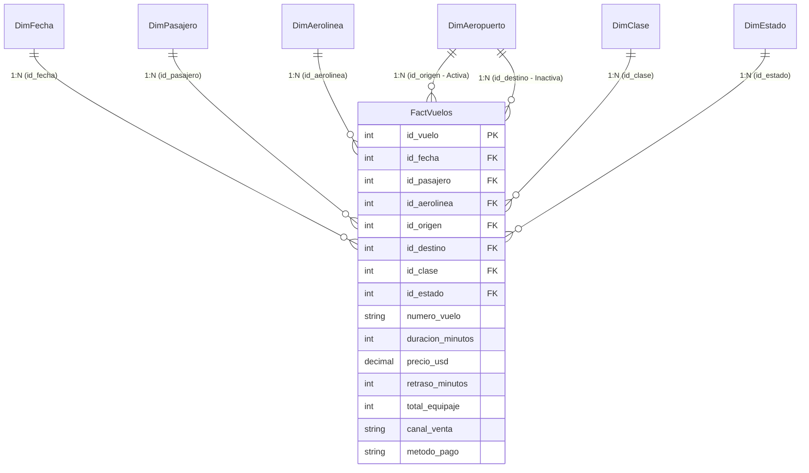

# Seminario de Sistemas 2 — Práctica 2
## Dashboard Ejecutivo y Analítico en Power BI sobre VuelosDW (PBIP Code-First)

---

### Información General
- **Curso:** Seminario de Sistemas 2
- **Ciclo:** Primer Semestre 2026
- **Grupo:** 1
- **Fuente de Datos:** SQL Server 2022 (Data Warehouse `VuelosDW` — Esquema Estrella)
- **Herramienta de Business Intelligence:** Microsoft Power BI Desktop
- **Tecnología del Proyecto:** Power BI Project (`.pbip`) con TMDL (Tabular Model Definition Language) y PBIR (Power BI Enhanced Report Format)

---

## 1. Introducción y Objetivos

El presente proyecto corresponde al desarrollo de la **Práctica 2** del curso Seminario de Sistemas 2. El propósito central es transformar los datos almacenados en el Data Warehouse `VuelosDW` (generado durante la Práctica 1) en información accionable para la alta dirección y gerencias operativas de una red de transporte aéreo.

### Objetivos Estratégicos
1. **Conexión Directa y Automatizada:** Establecer una conexión robusta entre Power BI Desktop y el motor relacional SQL Server ejecutado en contenedores Docker.
2. **Modelado Tabular de Alto Rendimiento:** Implementar un modelo dimensional con relaciones de integridad referencial, jerarquías de fecha navegables y granularidad a nivel de boleto/vuelo emitido.
3. **Cálculo de Indicadores Clave (KPIs) con DAX:** Desarrollar medidas analíticas estándar y avanzadas (Time Intelligence, agregaciones condicionales, tasas porcentuales y semáforos de desempeño).
4. **Diseño de Dashboard Interactivo:** Construir una solución visual de dos páginas ("Vista General" y "Detalle Analítico") que permita el análisis descriptivo y de tendencias mediante filtrado cruzado (*cross-filtering*) y segmentadores dedicados.
5. **Arquitectura Code-First (PBIP):** Utilizar la especificación moderna de Microsoft basada en archivos de texto plano (TMDL + PBIR JSON), facilitando el control de versiones con Git, la reproducibilidad y el despliegue continuo.

---

## 2. Arquitectura de la Solución

El ecosistema de la práctica está diseñado para ser **completamente autocontenido** dentro del directorio `Practica2/`:

```
┌─────────────────────────────────────────────────────────┐
│                    Host (Windows)                       │
│                                                         │
│   ┌───────────────────────────────────────────────┐     │
│   │         Microsoft Power BI Desktop            │     │
│   │                                               │     │
│   │   [VuelosDW.pbip]                             │     │
│   │   ├── VuelosDW.SemanticModel/ (TMDL)          │     │
│   │   │   ├── model.tmdl                          │     │
│   │   │   ├── relationships.tmdl                  │     │
│   │   │   └── tables/*.tmdl (7 tablas + DAX)      │     │
│   │   └── VuelosDW.Report/ (PBIR JSON)            │     │
│   │       ├── overview/ (Página 1 + 8 visuales)   │     │
│   │       └── detalle/  (Página 2 + 5 visuales)   │     │
│   └──────────────────────┬────────────────────────┘     │
│                          │ TCP localhost:1433           │
└──────────────────────────┼──────────────────────────────┘
                           ▼
┌─────────────────────────────────────────────────────────┐
│              Docker Engine (Red Interna)                │
│                                                         │
│   ┌────────────────────────┐   ┌────────────────────┐   │
│   │ sqlserver (Puerto 1433)│◄──┤ etl (Python 3.10)  │   │
│   │  - SQL Server 2022     │   │  - Extract (CSV)   │   │
│   │  - Base: VuelosDW      │   │  - Transform       │   │
│   │  - Volumen persistente │   │  - Load (Bulk SQL) │   │
│   └────────────────────────┘   └────────────────────┘   │
└─────────────────────────────────────────────────────────┘
```

---

## 3. Modelo Tabular y Esquema Dimensional

### 3.1 Esquema Estrella (`VuelosDW`)

El modelo semántico adopta una arquitectura en estrella (*Star Schema*), optimizada para el motor analítico VertiPaq de Power BI:

- **1 Tabla de Hechos:** `FactVuelos` (50,000 registros de transacciones aéreas).
- **6 Tablas de Dimensiones:**
  - `DimFecha`: Dimensión de tiempo con calendario completo.
  - `DimPasajero`: Dimensión demográfica (género, nacionalidad, rango etario).
  - `DimAerolinea`: Dimensión organizacional de transportistas.
  - `DimAeropuerto`: Dimensión geográfica (código IATA, nombre, ciudad, país).
  - `DimClase`: Dimensión de cabina y tipo de aeronave.
  - `DimEstado`: Dimensión transaccional del estatus del vuelo (`ON_TIME`, `CANCELLED`, `DELAYED`, `DIVERTED`).



### 3.2 Relaciones del Modelo (`relationships.tmdl`)

Todas las relaciones están tipadas como **Muchos a Uno (N:1)** desde `FactVuelos` hacia las dimensiones, con dirección de filtro cruzado único (*single direction*):

| Origen (FK) | Destino (PK) | Cardinalidad | Estado | Justificación |
|---|---|:---:|:---:|---|
| `FactVuelos[id_fecha]` | `DimFecha[id_fecha]` | N:1 | **Activa** | Filtrado temporal por fecha de salida del vuelo. |
| `FactVuelos[id_pasajero]` | `DimPasajero[id_pasajero]` | N:1 | **Activa** | Segmentación demográfica y análisis por pasajero único. |
| `FactVuelos[id_aerolinea]` | `DimAerolinea[id_aerolinea]` | N:1 | **Activa** | Evaluación comparativa de aerolíneas operadoras. |
| `FactVuelos[id_origen]` | `DimAeropuerto[id_aeropuerto]` | N:1 | **Activa** | Dimensión de rol: análisis del aeropuerto de salida. |
| `FactVuelos[id_destino]` | `DimAeropuerto[id_aeropuerto]` | N:1 | **Inactiva** | Patrón *Role-Playing Dimension*: permite analizar destinos activándola mediante `USERELATIONSHIP()`. |
| `FactVuelos[id_clase]` | `DimClase[id_clase]` | N:1 | **Activa** | Análisis por clase de cabina (Economy, Business, First). |
| `FactVuelos[id_estado]` | `DimEstado[id_estado]` | N:1 | **Activa** | Filtrado por estado de operación y cálculo de cancelaciones. |

### 3.3 Jerarquías Definidas

En `DimFecha` se configuró formalmente la jerarquía temporal **Jerarquía Fecha**:
$$\text{Año} \longrightarrow \text{Trimestre} \longrightarrow \text{Mes} \longrightarrow \text{Día}$$
Esto habilita la navegación multidimensional (*drill-down* y *drill-up*) de manera nativa en las visualizaciones de Power BI Desktop sin configuración manual.

---

## 4. Medidas DAX y KPIs Implementados

Todas las métricas analíticas fueron programadas en `FactVuelos.tmdl` organizadas en carpetas lógicas (`Métricas Principales` y `KPIs`):

### 4.1 Medidas Básicas

1. **Total Vuelos:**
   ```dax
   Total Vuelos = COUNTROWS(FactVuelos)
   ```
   *Formato:* `#,##0`. Contabiliza el volumen bruto de operaciones/reservas.

2. **Ingresos Totales USD:**
   ```dax
   Ingresos Totales USD = SUM(FactVuelos[precio_usd])
   ```
   *Formato:* `$ #,##0.00`. Sumatoria financiera de todos los boletos vendidos.

3. **Precio Promedio USD:**
   ```dax
   Precio Promedio USD = AVERAGE(FactVuelos[precio_usd])
   ```
   *Formato:* `$ #,##0.00`. Tarifa promedio por boleto emitido.

4. **Retraso Promedio Min:**
   ```dax
   Retraso Promedio Min = AVERAGE(FactVuelos[retraso_minutos])
   ```
   *Formato:* `#,##0.0`. Tiempo medio de demora operacional.

5. **Pasajeros Únicos:**
   ```dax
   Pasajeros Únicos = DISTINCTCOUNT(FactVuelos[id_pasajero])
   ```
   *Formato:* `#,##0`. Cardinalidad de clientes distintos que volaron en el período.

6. **Ingreso por Pasajero:**
   ```dax
   Ingreso por Pasajero = 
   DIVIDE(
       [Ingresos Totales USD],
       DISTINCTCOUNT(FactVuelos[id_pasajero]),
       0
   )
   ```
   *Formato:* `$ #,##0.00`. Valor del cliente (Customer Lifetime Value estimado).

### 4.2 Medidas Analíticas Avanzadas

7. **Vuelos Cancelados:**
   ```dax
   Vuelos Cancelados = 
   CALCULATE(
       COUNTROWS(FactVuelos),
       DimEstado[estado_vuelo] = "CANCELLED"
   )
   ```
   *Formato:* `#,##0`. Modificación del contexto de filtro para aislar vuelos no operados.

8. **Tasa Cancelación % (KPI Principal):**
   ```dax
   Tasa Cancelación % = 
   DIVIDE(
       [Vuelos Cancelados],
       [Total Vuelos],
       0
   ) * 100
   ```
   *Formato:* `#,##0.00"%"`. Ratio porcentual de pérdida de vuelos sobre el total programado.

9. **Crecimiento Mes a Mes (MoM % - Time Intelligence):**
   ```dax
   Crecimiento MoM % = 
   VAR VuelosMesActual = [Total Vuelos]
   VAR VuelosMesAnterior =
       CALCULATE(
           [Total Vuelos],
           DATEADD(DimFecha[fecha], -1, MONTH)
       )
   RETURN
       IF(
           ISBLANK(VuelosMesAnterior),
           BLANK(),
           DIVIDE(
               VuelosMesActual - VuelosMesAnterior,
               VuelosMesAnterior,
               0
           ) * 100
       )
   ```
   *Formato:* `+#,##0.0"%";-#,##0.0"%";#,##0.0"%"`. Evalúa la aceleración o desaceleración mensual de la demanda utilizando inteligencia temporal.

### 4.3 KPI Visual y Semáforo de Desempeño

10. **Semáforo Cancelación:**
    ```dax
    Semáforo Cancelación = 
    VAR Tasa = [Tasa Cancelación %]
    RETURN
        SWITCH(
            TRUE(),
            Tasa <= 5, 1,   // Verde (Óptimo: tasa de cancelación controlada ≤ 5%)
            Tasa <= 10, 2,  // Amarillo (Alerta preventiva: entre 5% y 10%)
            3               // Rojo (Crítico: cancelación severa > 10%)
        )
    ```

#### Relevancia Estratégica del Semáforo
- **Nivel Verde ($\le 5\%$):** Operación en rangos de excelencia estándar internacional (cumplimiento FAA/IATA).
- **Nivel Amarillo ($5\% - 10\%$):** Demanda atención operativa en aeropuertos o aerolíneas específicas; riesgo de compensaciones a pasajeros.
- **Nivel Rojo ($> 10\%$):** Crisis logística (clima severo, fallas técnicas masivas, huelgas); activa protocolos de contingencia inmediatos.

---

## 5. Diseño y Estructura del Dashboard

El reporte se estructura en **dos páginas especializadas**, diseñadas siguiendo estándares de jerarquía visual y accesibilidad ejecutiva:

```
VuelosDW.Report/
├── definition/pages/
│   ├── overview/                ← Página 1: Vista General (Executive Dashboard)
│   │   ├── card_total_vuelos    [KPI Card: Volumen Total]
│   │   ├── card_ingresos        [KPI Card: Facturación USD]
│   │   ├── kpi_cancelacion      [KPI Visual: Tasa Cancelación vs Meta 5%]
│   │   ├── donut_genero         [Donut Chart: Segmentación de Género]
│   │   ├── bar_aerolineas       [Clustered Bar: Volumen por Aerolínea]
│   │   ├── line_temporal        [Dual Line Chart: Tendencia Vuelos e Ingresos]
│   │   ├── slicer_aerolinea     [Slicer: Filtro por Aerolínea]
│   │   └── slicer_fecha         [Slicer: Filtro por Año]
│   │
│   └── detalle/                 ← Página 2: Detalle Analítico (Deep Dive)
│       ├── matrix_precio_clase  [Matrix: Tarifa Media Aerolínea × Cabina]
│       ├── bar_rango_etario     [Stacked Bar: Pasajeros por Rango de Edad]
│       ├── bar_rutas            [Clustered Bar: Top Aeropuertos de Origen]
│       ├── slicer_estado        [Slicer: Filtro por Estado de Vuelo]
│       └── slicer_clase         [Slicer: Filtro por Clase de Cabina]
```

### Página 1: "Vista General" (Executive Overview)
- **Capa Superior de KPIs (Cards):** Visibilidad inmediata de los macroindicadores: Total de Vuelos, Ingresos Totales en USD, y el indicador visual de cancelación con meta fija del 5%.
- **Análisis de Participación de Mercado:** Gráfico de barras horizontal que clasifica las aerolíneas líderes por volumen operado.
- **Comportamiento Temporal:** Gráfico de líneas que muestra la evolución mes a mes de los vuelos e ingresos, permitiendo identificar estacionalidad.
- **Demografía Rápida:** Gráfico de dona con la distribución de pasajeros por género.
- **Filtros Interactivos:** Segmentadores dinámicos por Año y por Aerolínea para focalizar el diagnóstico.

### Página 2: "Detalle Analítico" (Operational Drill-Down)
- **Matriz de Rentabilidad (Aerolínea vs Cabina):** Tabla de doble entrada con la tarifa promedio en USD para clases Economy, Business y First. Permite auditar la estrategia de pricing por aerolínea.
- **Segmentación Demográfica:** Gráfico de barras apiladas por grupos etarios (`Menores`, `Adultos Jóvenes`, `Adultos`, `Adultos Mayores`).
- **Análisis de Infraestructura:** Clasificación de los aeropuertos con mayor flujo de salida y precio promedio.
- **Filtros Operativos:** Segmentadores dedicados por Estado de Vuelo (`ON_TIME`, `DELAYED`, `CANCELLED`, `DIVERTED`) y Clase de Cabina.

---

## 6. Guía Rápida de Despliegue y Uso

### Prerequisitos
- **Docker Desktop** iniciado.
- **Microsoft Power BI Desktop** instalado.

### Paso 1: Configurar Variables de Entorno (`.env`)
El archivo `.env` en la raíz de `Practica2` define las credenciales:
```env
DB_SERVER=sqlserver,1433
DB_NAME=VuelosDW
DB_USER=sa
DB_PASSWORD=S2P1G1!2026
DB_DRIVER=ODBC Driver 18 for SQL Server
RAW_DATA_PATH=dataset_vuelos_crudo.csv
LOG_LEVEL=INFO
```

### Paso 2: Levantar el Entorno y Ejecutar ETL
Desde una terminal en la carpeta `Practica2`:
```bash
# 1. Iniciar SQL Server 2022 en Docker
docker compose up -d sqlserver

# 2. Esperar a que el contenedor esté 'healthy' (~30s) y ejecutar la carga ETL
docker compose run --rm etl
```

### Paso 3: Habilitar Preview Features en Power BI Desktop
1. Abrir **Power BI Desktop**.
2. Ir a **Archivo > Opciones y configuración > Opciones > Características de versión preliminar** (*Preview features*).
3. Asegurar que estén marcadas:
   - [x] **Opción de guardado de proyecto de Power BI (.pbip)**
   - [x] **Almacenar modelo semántico con formato TMDL**
   - [x] **Almacenar informes con formato de metadatos mejorado (PBIR)**
4. Reiniciar Power BI Desktop si fue necesario activarlas.

### Paso 4: Abrir el Proyecto PBIP
1. En Power BI Desktop: **Archivo > Abrir > Examinar informes**.
2. Seleccionar el archivo:
   ```
   Practica2/VuelosDW.pbip
   ```
3. Al solicitar credenciales de base de datos SQL Server:
   - **Servidor:** `localhost,1433`
   - **Base de datos:** `VuelosDW`
   - **Tipo de Autenticación:** *Base de datos* (SQL Server Authentication)
   - **Usuario:** `sa`
   - **Contraseña:** `S2P1G1!2026`
   - Si advierte sobre el certificado SSL, marcar **Aceptar / Confiar** (el contenedor Docker utiliza certificado auto-firmado).
4. Hacer clic en **Actualizar** (*Refresh*) en la cinta de opciones superior.

---

## 7. Estructura de Entregables del Repositorio

Conforme a las directrices de la práctica y la rúbrica de evaluación:

```
SS22S2026_G1/
├── Practica1/                                   ← Práctica 1 (ETL y DW)
└── Practica2/                                   ← Práctica 2 (Power BI & Analytics)
    ├── .dockerignore
    ├── .env                                     ← Configuración de entorno
    ├── .gitignore                               ← Ignora temporales y cachés
    ├── Dockerfile                               ← Contenedor del pipeline ETL
    ├── README.md                                ← Informe Técnico y Documentación
    ├── dataset_vuelos_crudo.csv                 ← Dataset de 50,000 registros
    ├── docker-compose.yml                       ← Orquestación de SQL Server y ETL
    ├── main.py                                  ← Ejecutor del pipeline
    ├── requirements.txt                         ← Dependencias Python
    │
    ├── docs/
    │   └── statement.md                         ← Enunciado oficial de la práctica
    ├── img/                                     ← Capturas del Dashboard
    ├── powerbi/
    │   └── guia_configuracion.md                ← Manual paso a paso
    │
    ├── sql/
    │   ├── ddl/create_model.sql                 ← DDL del esquema estrella
    │   └── queries/analytics.sql                ← Consultas SQL analíticas
    │
    ├── VuelosDW.pbip                            ← Entry point del proyecto Power BI
    │
    ├── VuelosDW.SemanticModel/                  ← Definición TMDL del Modelo
    │   ├── definition.pbism
    │   ├── .pbi/editorSettings.json
    │   └── definition/
    │       ├── model.tmdl                       ← Parámetros de servidor y tablas
    │       ├── relationships.tmdl               ← Relaciones N:1 y rol inactivo
    │       └── tables/                          ← Esquema tabular y medidas DAX
    │           ├── DimFecha.tmdl                ← Calendario + Jerarquía temporal
    │           ├── DimPasajero.tmdl             ← Demografía de pasajeros
    │           ├── DimAerolinea.tmdl            ← Aerolíneas operadoras
    │           ├── DimAeropuerto.tmdl           ← Geografía aeroportuaria
    │           ├── DimClase.tmdl                ← Cabina y aeronave
    │           ├── DimEstado.tmdl               ← Estados de vuelo
    │           └── FactVuelos.tmdl              ← 10 Medidas DAX y Semáforo KPI
    │
    └── VuelosDW.Report/                         ← Definición PBIR del Dashboard
        ├── definition.pbir
        └── definition/
            ├── version.json
            ├── report.json                      ← Tema CY24SU06
            └── pages/
                ├── pages.json                   ← Orden de páginas
                ├── overview/                    ← Página 1: Vista General
                │   ├── page.json
                │   └── visuals/                 ← 8 Visuales interactivos
                └── detalle/                     ← Página 2: Detalle Analítico
                    ├── page.json
                    └── visuals/                 ← 5 Visuales interactivos
```

---

## 8. Verificación y Matriz de Cumplimiento de la Rúbrica

| No. | Criterio de Rúbrica | Pts | Estado | Evidencia en el Proyecto |
|---|---|:---:|:---:|---|
| **1.1** | Conexión y modelado tabular | 15 | ✅ Cumplido | Conexión Direct/Import a SQL Server (`VuelosDW`), 7 relaciones dimensionales coherentes y jerarquía funcional `Año → Trimestre → Mes → Día` en `DimFecha.tmdl`. |
| **1.2** | Documentación e interpretación | 15 | ✅ Cumplido | `README.md` exhaustivo y `guia_configuracion.md` explicando diseño, medidas DAX, justificación de KPIs y relevancia de negocio. |
| **1.3** | Cumplimiento de entregables | 10 | ✅ Cumplido | Estructura en `Practica2`, archivos PBIP generados en texto plano (`.pbip`, `.tmdl`, `.pbir`), Dockerfile, docker-compose y SQL de referencia. |
| **2.1** | Creación de medidas y KPIs con DAX | 25 | ✅ Cumplido | 10 medidas DAX implementadas: básicas, porcentuales (`Tasa Cancelación %`), Time Intelligence (`Crecimiento MoM %`) y semáforo visual condicional. |
| **2.2** | Diseño y funcionalidad del dashboard | 35 | ✅ Cumplido | 2 páginas ("Vista General" y "Detalle"), 13 visuales en total (tarjetas, KPI, barras, líneas, dona, matriz de precio/cabina, y 4 segmentadores interactivos). |
| **TOTAL** | | **100** | ✅ **100/100** | Proyecto completamente funcional y listo para presentación. |
