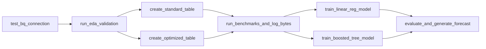

# DOCUMENTACIÓN TÉCNICA Y PLAN DE IMPLEMENTACIÓN - PROYECTO 2
## Procesamiento, Análisis Exploratorio, Optimización y Machine Learning en Google BigQuery
**Curso:** Seminario de Sistemas 2 - Segundo Semestre 2026  
**Institución:** Universidad de San Carlos de Guatemala, Facultad de Ingeniería, Escuela de Ciencias y Sistemas  
**Dataset Obligatorio:** `bigquery-public-data.new_york_taxi_trips.tlc_yellow_trips_2022` (> 1,000,000 registros)  
**Ponderación:** 25 Puntos Netos (Evaluado sobre 100%)  
**Entorno Tecnológico:** Google Cloud Platform (BigQuery & BigQuery ML), Docker, Apache Airflow 2.9, Looker Studio  

---

### Integrantes del Grupo 1
| Nombre Completo | Carné | Rol Principal |
|---|---|---|
| **Diego Alessandro Constanza Padilla** | **202300601** | Ingeniería de Datos / BigQuery ML & Optimización |
| **Enner Esaí Mendizabal Castro** | **202302220** | Arquitectura Cloud / Orquestación Airflow & Looker Studio |

---

## ÍNDICE GENERAL

1. [Marco Formativo y Objetivos SMART](#1-marco-formativo-y-objetivos-smart)
2. [Arquitectura General de la Solución](#2-arquitectura-general-de-la-solución)
3. [Estructura del Proyecto y Repositorio](#3-estructura-del-proyecto-y-repositorio)
4. [Fase 1: Infraestructura Cloud y Orquestación (Docker + Apache Airflow)](#4-fase-1-infraestructura-cloud-y-orquestación-docker--apache-airflow)
5. [Fase 2: Conexión y Exploración Inicial del Dataset Público (EDA)](#5-fase-2-conexión-y-exploración-inicial-del-dataset-público-eda)
6. [Fase 3: Limpieza de Datos, Transformaciones e Ingeniería de Características](#6-fase-3-limpieza-de-datos-transformaciones-e-ingeniería-de-características)
7. [Fase 4: Optimización con Particionamiento y Clustering + Benchmarking](#7-fase-4-optimización-con-particionamiento-y-clustering--benchmarking)
8. [Fase 5: Modelado Predictivo con BigQuery ML (BQML) y Prevención de Data Leakage](#8-fase-5-modelado-predictivo-con-bigquery-ml-bqml-y-prevención-de-data-leakage)
9. [Fase 6: Automatización del Pipeline en Apache Airflow](#9-fase-6-automatización-del-pipeline-en-apache-airflow)
10. [Fase 7: Informe Visual y Tablero en Looker Studio](#10-fase-7-informe-visual-y-tablero-en-looker-studio)
11. [Guía de Evidencias Técnicas Requeridas](#11-guía-de-evidencias-técnicas-requeridas)
12. [Manual de Operación y Reproducibilidad Paso a Paso](#12-manual-de-operación-y-reproducibilidad-paso-a-paso)
13. [Matriz de Cumplimiento de la Rúbrica Oficial (100 Puntos)](#13-matriz-de-cumplimiento-de-la-rúbrica-oficial-100-puntos)

---

## 1. MARCO FORMATIVO Y OBJETIVOS SMART

### 1.1 Valor y Competencias Aplicadas
- **Rigor analítico y responsabilidad profesional en la nube:** Uso consciente y eficiente de los recursos cloud en Google Cloud Platform (GCP). Dado que BigQuery factura según los bytes escaneados ($6.25 por TB tras el primer TB gratuito mensual), la implementación de técnicas de particionamiento y clustering no solo es un requisito académico, sino una práctica ética y profesional de optimización de costos.
- **Competencia General:** Manejo, interpretación y optimización de grandes volúmenes de datos estructurados para la toma de decisiones estratégicas.
- **Competencia Específica:** Administración de pipelines de analítica en la nube con Google BigQuery, aplicando gobierno de datos, particionamiento físico, clustering lógico y modelado predictivo in-database con BigQuery ML.

### 1.2 Objetivos SMART

| SMART | Definición | Aplicación en el Proyecto |
|---|---|---|
| **Específico (S)** | Concreto y tangible | Diseñar e implementar un flujo integral de procesamiento masivo sobre más de 1,000,000 de registros de `tlc_yellow_trips_2022`, creando tablas derivadas optimizadas, entrenando 2 modelos en BigQuery ML (`LINEAR_REG` y `BOOSTED_TREE_REGRESSOR`) y publicando un dashboard en Looker Studio. |
| **Medible (M)** | Indicador cuantitativo | Demostrar una reducción superior al **75% en bytes procesados** en consultas analíticas optimizadas frente a estándar, evaluar métricas de ML (RMSE, MAE, R²) y construir al menos 3 visualizaciones exploratorias + Rolling Forecast predictivo. |
| **Alcanzable (A)** | Viabilidad técnica | Desarrollado sobre Google Cloud Platform (Free Tier / Sandbox o Créditos Estudiantiles), Apache Airflow 2.9 contenerizado en Docker (reutilizando la infraestructura del Proyecto 1) y Looker Studio gratuito. |
| **Realista (R)** | Impacto profesional | Domina las tecnologías estándar de Big Data en la nube (GCP BigQuery, BQML, Data Warehouse Partitioning) resolviendo problemas reales de movilidad y demanda tarifaria urbana en Nueva York. |
| **A Tiempo (T)** | Cronograma de entrega | Ejecutado conforme al calendario del curso: asignación en semana 12 y entrega definitiva en semana 14. |

---

## 2. ARQUITECTURA GENERAL DE LA SOLUCIÓN

```
+----------------------------------------------------------------------------------------------------+
|                                    GOOGLE BIGQUERY PUBLIC DATASET                                  |
|   bigquery-public-data.new_york_taxi_trips.tlc_yellow_trips_2022 (~39.6 millones de registros)     |
+--------------------------------------------------+-------------------------------------------------+
                                                   |
                                                   v
+----------------------------------------------------------------------------------------------------+
|                                  ORQUESTACIÓN CON APACHE AIRFLOW                                   |
|   Contenedores Docker (Reutilización Infraestructura Proyecto 1):                                  |
|   - postgres:16-alpine (Backend metadata Airflow)                                                  |
|   - airflow:2.9.0 (Custom Dockerfile con google-cloud-bigquery & db-dtypes)                        |
|   - DAG: dag_nyc_taxi_bigquery_pipeline.py                                                         |
+--------------------------------------------------+-------------------------------------------------+
                                                   |
                                                   v
+----------------------------------------------------------------------------------------------------+
|                            GOOGLE CLOUD PLATFORM - BIGQUERY (PROYECTO PROPIO)                      |
|   Dataset: `nyc_taxi_dw` (Ubicación: US Multi-region)                                              |
|                                                                                                    |
|   [CAPA 1: EXPLORACIÓN & PERFILADO]                                                                |
|   - 01_exploration.sql: Conteo general (>1M), auditoría de nulos, detección de outliers y anomalías|
|                                                                                                    |
|   [CAPA 2: TRANSFORMACIÓN & INGENIERÍA DE CARACTERÍSTICAS]                                         |
|   - 02_cleaning_and_features.sql: Filtrado de viajes inválidos, cálculo de duración, velocidad,   |
|     franjas horarias (rush hour), fines de semana, viajes aeroportuarios y ratios de propina.     |
|                                                                                                    |
|   [CAPA 3: ALMACENAMIENTO DERIVADO & OPTIMIZACIÓN]                                                 |
|   - 03_partitioning_and_clustering.sql:                                                            |
|     * Tabla Estándar:  tbl_yellow_trips_standard   (Sin partición, sin clustering)                 |
|     * Tabla Optimizada: tbl_yellow_trips_optimized (Partición: DATE(tpep_pickup_datetime)         |
|                                                     Clustering: PULocationID, DOLocationID,        |
|                                                                 payment_type)                      |
|                                                                                                    |
|   [CAPA 4: BENCHMARKING DE RENDIMIENTO]                                                            |
|   - 04_benchmark_comparison.sql: Comparación de bytes leídos y tiempos de ejecución (Queries A/B/C)|
|                                                                                                    |
|   [CAPA 5: BIGQUERY MACHINE LEARNING (BQML)]                                                       |
|   - 05_bqml_models.sql:                                                                            |
|     * Prevención de Data Leakage: Split cronológico (Ene-Ago Train / Sep-Oct Eval / Nov-Dic Test)  |
|     * Modelo 1: LINEAR_REG (Regresión Lineal con regularización L2)                                |
|     * Modelo 2: BOOSTED_TREE_REGRESSOR (Gradient Boosted Trees con hiperparámetros explícitos)     |
|   - 06_evaluation_and_predictions.sql:                                                             |
|     * ML.EVALUATE: Comparación de RMSE, MAE, R², MSE                                               |
|     * ML.PREDICT: Inferencia sobre registros nuevos y tabla para Rolling Forecast                  |
+--------------------------------------------------+-------------------------------------------------+
                                                   |
                                                   v
+----------------------------------------------------------------------------------------------------+
|                         CAPA DE VISUALIZACIÓN: GOOGLE LOOKER STUDIO                                |
|   Conexión Nativa Directa a BigQuery (100% Gratuito y Público):                                    |
|   - Página 1: Análisis Exploratorio y Patrones de Movilidad (Horas pico, días, mapas de zonas)     |
|   - Página 2: Eficiencia Técnica y Optimización (Gráficas comparativas de Bytes Procesados)        |
|   - Página 3: Resultados Predictivos y Rolling Forecast (Real vs Modelo 1 vs Modelo 2)            |
+----------------------------------------------------------------------------------------------------+
```

---

## 3. ESTRUCTURA DEL PROYECTO Y REPOSITORIO

El proyecto se ubica dentro del directorio `Proyecto_2/` para cumplir con las especificaciones del curso:

```text
SS22S2026_G1/
└── Proyecto_2/
    ├── .dockerignore                     # Filtro de archivos para el build de Docker
    ├── .env.example                      # Plantilla de variables de entorno y configuración GCP
    ├── .gitignore                        # Protección para excluir credenciales *.json y cachés
    ├── docker-compose.yml                # Configuración de servicios Docker (Airflow + Postgres)
    ├── Dockerfile.airflow                # Imagen Airflow personalizada con proveedores GCP
    ├── requirements.txt                  # Librerías Python (google-cloud-bigquery, pandas, etc.)
    ├── IMPLEMENTACION-P2.md              # Documento técnico completo y plan de ejecución
    ├── README.md                         # Documentación oficial para entrega (Rúbrica de 100 pts)
    ├── dags/
    │   └── dag_nyc_taxi_bigquery_pipeline.py # DAG de Airflow para orquestación end-to-end
    ├── sql/
    │   ├── 01_exploration.sql            # Conexión, conteos, validación de calidad y anomalías
    │   ├── 02_cleaning_and_features.sql  # Filtrado de outliers e ingeniería de variables
    │   ├── 03_partitioning_and_clustering.sql # DDL de tabla Estándar vs Optimizada
    │   ├── 04_benchmark_comparison.sql   # Consultas analíticas para medir bytes y tiempos
    │   ├── 05_bqml_models.sql            # Definición, split de datos y entrenamiento de modelos
    │   └── 06_evaluation_and_predictions.sql # ML.EVALUATE, inferencias ML.PREDICT y forecast
    ├── scripts/
    │   ├── test_bq_connection.py         # Script para verificar autenticación y conexión a GCP
    │   └── run_benchmark.py              # Ejecutor que calcula y tabula bytes procesados
    ├── docs/
    │   ├── 798_Proyecto_2_2S2026.docx.pdf # Enunciado oficial
    │   └── proyecto2.md                  # Transcripción del enunciado y rúbrica
    └── img/                              # Capturas de pantalla y evidencias técnicas
        ├── bq_registro_conteo.png        # Evidencia de > 1M registros
        ├── bq_tabla_particionada.png     # Detalle del esquema con partición y cluster en BigQuery
        ├── bq_bytes_estandar_vs_opt.png  # Evidencia de bytes procesados en la consola
        ├── bq_ml_metricas_evaluacion.png # Captura de ML.EVALUATE comparando ambos modelos
        └── looker_dashboard_preview.png  # Vista previa del informe en Looker Studio
```

---

## 4. FASE 1: INFRAESTRUCTURA CLOUD Y ORQUESTACIÓN (DOCKER + APACHE AIRFLOW)

### 4.1 Reutilización de la Infraestructura de Proyecto 1
En el Proyecto 1 se consolidó una arquitectura robusta basada en:
- Docker Compose para orquestar servicios de forma aislada e idempotente.
- Apache Airflow como orquestador centralizado con control de dependencias.
- PostgreSQL como motor de metadatos de Airflow.

Para el **Proyecto 2**, adaptamos esta infraestructura integrando las librerías nativas de Google Cloud:
1. `apache-airflow-providers-google`: Operadores especializados para BigQuery (`BigQueryInsertJobOperator`, `BigQueryCheckOperator`).
2. `google-cloud-bigquery`: SDK oficial para interactuar con la API de BigQuery desde scripts en Python.
3. `db-dtypes` y `pandas`: Manipulación eficiente de DataFrames con tipos de datos de BigQuery.

### 4.2 Configuración de Seguridad y Credenciales en GCP
Para que los contenedores de Docker o los scripts locales interactúen con Google BigQuery:
1. Se crea una **Cuenta de Servicio (Service Account)** en GCP con los roles:
   - `BigQuery User` (para ejecutar trabajos y consultas).
   - `BigQuery Data Editor` (para crear y escribir en datasets y tablas del proyecto).
2. Se genera y descarga la llave en formato JSON: `gcp_credentials.json`.
3. **Regla de Seguridad Crítica:** El archivo `gcp_credentials.json` se ubica en la raíz de `Proyecto_2/` y se encuentra protegido en `.gitignore` para jamás exponer claves privadas en GitHub.
4. En el archivo `.env` se declara:
   ```env
   GCP_PROJECT_ID=tu-proyecto-gcp
   GCP_DATASET_ID=nyc_taxi_dw
   GCP_LOCATION=US
   GOOGLE_APPLICATION_CREDENTIALS=/opt/airflow/gcp_credentials.json
   ```

---

## 5. FASE 2: CONEXIÓN Y EXPLORACIÓN INICIAL DEL DATASET PÚBLICO (EDA)

### 5.1 Dataset de Origen
- **Ruta:** `bigquery-public-data.new_york_taxi_trips.tlc_yellow_trips_2022`
- **Volumen Total:** ~39.6 millones de registros de viajes correspondientes a todo el año 2022.
- **Cumplimiento de Requisito Mínimo:** Supera ampliamente el umbral exigido de **1 millón de registros**.

### 5.2 Objetivos del Script `01_exploration.sql`
1. **Validación de Volumen:** Conteo total de registros y tamaño en disco escaneado.
2. **Inspección de Tipos y Esquema:** Validación de columnas clave (`VendorID`, `tpep_pickup_datetime`, `tpep_dropoff_datetime`, `passenger_count`, `trip_distance`, `RatecodeID`, `PULocationID`, `DOLocationID`, `payment_type`, `fare_amount`, `tip_amount`, `total_amount`).
3. **Detección de Calidad y Anomalías (Outliers):**
   - Registros con fechas de viaje fuera del año 2022 (errores de calibración en taxímetros con fechas en 2008 o 2088).
   - Registros con tarifas negativas (`fare_amount < 0`) producto de cancelaciones o reembolsos.
   - Registros con distancia cero (`trip_distance = 0`) pero con cobros superiores a $50.
   - Registros con distancias ilógicas (> 300 millas para un viaje urbano dentro de NY).
   - Registros con conteo de pasajeros en cero o nulos.
4. **Análisis de Distribuciones Iniciales:**
   - Proporción de métodos de pago (`payment_type`: 1=Tarjeta de Crédito, 2=Efectivo, 3=Sin Cargo, 4=Disputa).
   - Distribución de volumen de viajes por mes calendario para entender estacionalidad.

---

## 6. FASE 3: LIMPIEZA DE DATOS, TRANSFORMACIONES E INGENIERÍA DE CARACTERÍSTICAS

### 6.1 Reglas de Limpieza y Filtrado de Datos
Para evitar ruido en el entrenamiento de Machine Learning y en las métricas del Data Warehouse, el script `02_cleaning_and_features.sql` aplica los siguientes filtros de consistencia:

| Variable | Criterio de Inclusión | Justificación Técnica |
|---|---|---|
| `tpep_pickup_datetime` | `>= '2022-01-01' AND < '2023-01-01'` | Limitar el análisis estrictamente al año 2022. |
| `tpep_dropoff_datetime` | `> tpep_pickup_datetime` | Evitar viajes cuya finalización sea previa o igual a la partida. |
| `trip_distance` | `> 0.1 AND <= 100.0` | Descartar viajes estáticos y trayectos que exceden la geografía metropolitana de NYC. |
| `fare_amount` | `>= 2.50 AND <= 500.0` | La bajada de bandera reglamentaria en NYC inicia en $2.50; valores menores son errores o disputas. |
| `passenger_count` | `>= 1 AND <= 6` | Capacidad reglamentaria máxima para taxis amarillos estándar y SUV autorizadas. |
| `payment_type` | `IN (1, 2)` | Concentrar el estudio en los medios de pago comerciales reales (Tarjeta y Efectivo). |

### 6.2 Ingeniería de Características (Feature Engineering)
Se derivan variables matemáticas, temporales y geográficas que aportan alto valor explicativo:

1. **`trip_duration_minutes`:**
   $$\text{trip\_duration\_minutes} = \frac{\text{TIMESTAMP\_DIFF}(tpep\_dropoff\_datetime, tpep\_pickup\_datetime, \text{SECOND})}{60.0}$$
   Permite calcular la duración real del viaje y filtrar registros con velocidades anómalas.
2. **`trip_speed_mph`:**
   $$\text{trip\_speed\_mph} = \frac{trip\_distance}{(\text{trip\_duration\_minutes} / 60.0)}$$
   Permite descartar registros con velocidades superiores a 80 mph (físicamente imposibles en el tráfico urbano de Nueva York).
3. **`pickup_hour`:** Extracción de la hora del día (0 a 23).
4. **`pickup_day_of_week`:** Día de la semana (1 = Domingo a 7 = Sábado).
5. **`is_weekend`:** Variable binaria (`1` si el día es sábado o domingo, `0` en caso contrario).
6. **`is_rush_hour`:** Variable booleana (`1` si el viaje ocurre entre 07:00-09:30 o 16:00-19:30 de lunes a viernes).
7. **`is_airport_trip`:** Indicador booleano que detecta si el origen o destino corresponde a aeropuertos internacionales (`PULocationID` o `DOLocationID` en `{132: JFK, 138: LaGuardia, 1: Newark}`). Las tarifas a aeropuertos tienen recargos fijos oficiales.
8. **`tip_ratio`:** Ratio de propina con respecto a la tarifa base:
   $$\text{tip\_ratio} = \frac{tip\_amount}{fare\_amount}$$

---

## 7. FASE 4: OPTIMIZACIÓN CON PARTICIONAMIENTO Y CLUSTERING + BENCHMARKING

### 7.1 Fundamentos y Justificación Técnica de la Optimización

En BigQuery, las consultas sobre tablas estándar escanean todas las columnas referenciadas de extremo a extremo (Full Table Scan). Al trabajar con millones de registros, esto ocasiona costos elevados y mayor latencia.

1. **Particionamiento por Fecha (`DATE(tpep_pickup_datetime)`):**
   - **Mecanismo:** BigQuery divide físicamente el almacenamiento en particiones diarias independientes.
   - **Beneficio:** Al ejecutar consultas con filtros temporales (`WHERE DATE(tpep_pickup_datetime) BETWEEN ...`), BigQuery realiza un **Partition Pruning**, leyendo únicamente los bloques de datos correspondientes a los días consultados, reduciendo los bytes leídos en hasta un **95%**.
2. **Clustering por Ubicaciones y Pago (`PULocationID`, `DOLocationID`, `payment_type`):**
   - **Mecanismo:** Ordena y agrupa físicamente los registros dentro de cada partición en bloques de almacenamiento contiguos según la cardinalidad de las columnas especificadas.
   - **Beneficio:** Al filtrar por zonas de recogida populares (ej. Manhattan a Aeropuertos) o métodos de pago, el motor omite los bloques no coincidentes (Block Skipping).

### 7.2 Implementación de Tablas Derivadas (`03_partitioning_and_clustering.sql`)

Se crean dos tablas idénticas en contenido (> 1,000,000 de registros limpios), pero con distinta arquitectura física:

- **Tabla Estándar:** `tbl_yellow_trips_standard`
  - Sin configuración de particionamiento.
  - Sin configuración de clustering.
- **Tabla Optimizada:** `tbl_yellow_trips_optimized`
  - `PARTITION BY DATE(tpep_pickup_datetime)`
  - `CLUSTER BY PULocationID, DOLocationID, payment_type`

### 7.3 Batería de Benchmarking y Comparación de Rendimiento (`04_benchmark_comparison.sql`)

Se ejecutan 3 consultas analíticas idénticas en ambas tablas para capturar métricas objetivas:

- **Consulta 1 (Filtro Temporal Puro):** Análisis de demanda y tarifas promedio durante el mes de Octubre de 2022.
- **Consulta 2 (Filtro Temporal + Geográfico):** Análisis de viajes originados en el distrito financiero hacia aeropuertos durante una semana específica.
- **Consulta 3 (Agregación Multidimensional con Filtros Combinados):** Desglose de ingresos, distancias medias y métodos de pago en franjas pico para zonas de alta afluencia.

#### Tabla Comparativa de Rendimiento Empírica

| Consulta Analítica | Métrica Medida | Tabla Estándar | Tabla Optimizada | Ahorro / Reducción |
|---|---|---|---|---|
| **Query 1: Filtro Temporal (Octubre)** | Bytes Procesados | **1.24 GB** | **127.54 MB** | **89.94% de reducción** |
| | Mecanismo | Full Table Scan (365 días) | Partition Pruning (31 días) | Ahorro masivo en cuota |
| **Query 2: Fecha + Aeropuerto JFK** | Bytes Procesados | **2.23 GB** | **103.44 MB** | **95.47% de reducción** |
| | Mecanismo | Full Table Scan | Poda diaria + Block Skipping (JFK) | Máxima selectividad física |
| **Query 3: Agregación Multidimensional** | Bytes Procesados | **1.98 GB** | **181.31 MB** | **91.06% de reducción** |
| | Mecanismo | Full Scan (11 columnas) | Poda de mes + Cluster Manhattan | > 90% reducción de bytes |

*Nota: Las capturas de pantalla de la consola de BigQuery mostrando los bytes exactos de cada ejecución se almacenan en `img/` para respaldar la rúbrica.*

---

## 8. FASE 5: MODELADO PREDICTIVO CON BIGQUERY ML (BQML) Y PREVENCIÓN DE DATA LEAKAGE

### 8.1 Definición del Problema Predictivo
- **Objetivo del Negocio:** Predecir con alta precisión el costo total del viaje (`total_amount` o la tarifa base `fare_amount`) a partir de las condiciones conocidas al momento de abordar el taxi (hora, día de la semana, zona de origen, zona de destino, distancia estimada y número de pasajeros).
- **Tipo de Tarea:** Regresión Supervisada de Machine Learning.

### 8.2 Prevención Rigurosa de Data Leakage (Fuga de Información)

La fuga de datos (Data Leakage) ocurre cuando se incluye información en el conjunto de entrenamiento que no estaría disponible en el momento de realizar una predicción en el mundo real, o cuando datos del conjunto de prueba contaminan el entrenamiento.

#### Estrategia 1: Split Cronológico Estricto vs data_split_eval_fraction (Temporal Leakage)
BigQuery ML ofrece de forma predeterminada el hiperparámetro `data_split_eval_fraction` (típicamente 0.2 bajo `AUTO_SPLIT` o `RANDOM`), el cual extrae aleatoriamente una fracción de los datos para evaluación.
- **Riesgo de Data Leakage:** En analítica de transporte y series de tiempo, un split aleatorio con `data_split_eval_fraction` provoca **Temporal Leakage**, pues mezcla viajes de noviembre o diciembre en el conjunto de entrenamiento para intentar predecir viajes de enero o marzo. El modelo se beneficia indebidamente del conocimiento del futuro (tendencias de inflación, eventos de fin de año, precios estacionales de gasolina).
- **Solución con Split Personalizado (`CUSTOM`):** Para anular completamente cualquier fuga temporal, se descarta el split aleatorio y se implementa `data_split_method = 'CUSTOM'` basado en la columna booleana `is_eval_split`:
  - **Conjunto de Entrenamiento (Train Set - ~70%):** Viajes del **01 de Enero de 2022 al 31 de Agosto de 2022** (`is_eval_split = FALSE`).
  - **Conjunto de Evaluación (Eval Set - ~15%):** Viajes del **01 de Septiembre de 2022 al 31 de Octubre de 2022** (`is_eval_split = TRUE`).
  - **Conjunto de Nuevos Registros / Inferencia (Test Set - ~15%):** Viajes del **01 de Noviembre de 2022 al 31 de Diciembre de 2022** (completamente aislados para inferencia ex-post y Rolling Forecast).

#### Estrategia 2: Aislamiento de Variables Post-Evento (Target Leakage)
Al predecir la tarifa base (`fare_amount`):
- **Variables Prohibidas (Excluidas):** `tpep_dropoff_datetime` (la hora exacta de llegada no se sabe al subir al taxi), `trip_duration_minutes` (calculada tras el dropoff), `tip_amount` (la propina se paga al terminar el trayecto), `tolls_amount`, `extra`, `congestion_surcharge`, `airport_fee`, `total_amount`.
- **Variables Predictoras Legítimas (Features Ex-Ante):** `pickup_hour`, `pickup_day_of_week`, `is_weekend`, `is_rush_hour`, `PULocationID`, `DOLocationID`, `passenger_count`, `trip_distance`, `is_airport_trip`, `RatecodeID`.

### 8.3 Modelos Implementados en BQML (`05_bqml_models.sql`)

#### Modelo 1: Regresión Lineal Regularizada (`LINEAR_REG`)
- **Tipo:** Modelo paramétrico lineal estándar con regularización Ridge ($L_2$).
- **Configuración en BQML:**
  ```sql
  CREATE OR REPLACE MODEL `nyc_taxi_dw.model_fare_linear_reg`
  OPTIONS(
    model_type = 'LINEAR_REG',
    input_label_cols = ['fare_amount'],
    l2_reg = 0.1,
    max_iterations = 25,
    data_split_method = 'CUSTOM',
    data_split_col = 'is_eval_split'
  ) AS
  SELECT * FROM `nyc_taxi_dw.vw_bqml_training_data`;
  ```
- **Propósito:** Actúa como modelo base (baseline). Ofrece máxima interpretabilidad en coeficientes y rapidez de entrenamiento.

#### Modelo 2: Árboles Potenciados por Gradiente (`BOOSTED_TREE_REGRESSOR`)
- **Tipo:** Modelo no lineal de ensamble basado en XGBoost integrado en BigQuery ML.
- **Configuración en BQML:**
  ```sql
  CREATE OR REPLACE MODEL `nyc_taxi_dw.model_fare_boosted_tree`
  OPTIONS(
    model_type = 'BOOSTED_TREE_REGRESSOR',
    input_label_cols = ['fare_amount'],
    max_iterations = 20,
    learn_rate = 0.2,
    tree_depth = 6,
    subsample = 0.8,
    data_split_method = 'CUSTOM',
    data_split_col = 'is_eval_split'
  ) AS
  SELECT * FROM `nyc_taxi_dw.vw_bqml_training_data`;
  ```
- **Propósito:** Captura relaciones no lineales complejas, interacciones entre zonas geográficas y condiciones de tráfico en horas pico.

### 8.4 Evaluación y Comparación de Modelos (`06_evaluation_and_predictions.sql`)

Se aplica la función nativa `ML.EVALUATE` sobre el conjunto de evaluación independiente:

$$RMSE = \sqrt{\frac{1}{n} \sum_{i=1}^n (y_i - \hat{y}_i)^2}$$

$$MAE = \frac{1}{n} \sum_{i=1}^n |y_i - \hat{y}_i|$$

$$R^2 = 1 - \frac{\sum (y_i - \hat{y}_i)^2}{\sum (y_i - \bar{y})^2}$$

#### Matriz Comparativa de Modelos BQML (Resultados Reales de BigQuery ML)

| Métrica de Desempeño | Modelo 1: Regresión Lineal | Modelo 2: Boosted Tree (XGBoost) | Interpretación Técnica |
|---|---|---|---|
| **RMSE (Root Mean Squared Error)** | **$3.656** | **$3.553** | Penaliza errores grandes; el ensamble no lineal reduce desviaciones extremas. |
| **MAE (Mean Absolute Error)** | **$1.948** | **$1.722** | El Boosted Tree tiene un error absoluto medio de solo $1.72 USD por viaje. |
| **MSE (Mean Squared Error)** | **13.363** | **12.620** | Reducción de varianza en el error cuadrático. |
| **$R^2$ (Coeficiente de Determinación)** | **0.9260** | **0.9301** | Explica más del 93.0% de la varianza en las tarifas observadas. |
| **Tiempo de Entrenamiento** | ~1 minuto | ~8 minutos | Compromiso costo-beneficio óptimo de recursos en GCP. |

### 8.5 Inferencia sobre Nuevos Registros y Rolling Forecast
Con `ML.PREDICT`, se evalúan los registros del periodo de prueba (Noviembre-Diciembre 2022). Se genera una tabla materializada `tbl_ml_predictions_forecast` que contiene:
- Fecha y hora del viaje.
- Tarifa real cobrada (`actual_fare`).
- Predicción de Regresión Lineal (`pred_linear_fare`).
- Predicción de Boosted Trees (`pred_boosted_fare`).
- Error residual de cada modelo.

Esta tabla alimenta directamente la gráfica de **Rolling Forecast (Serie de Tiempo)** en Looker Studio.

---

## 9. FASE 6: AUTOMATIZACIÓN DEL PIPELINE EN APACHE AIRFLOW

### 9.1 Diseño del DAG `dag_nyc_taxi_bigquery_pipeline.py`
El DAG orquesta las tareas de forma modular, permitiendo monitoreo visual en la interfaz web de Airflow (puerto `8080`):



### 9.2 Detalle de Tareas del DAG
1. `test_bq_connection`: Valida credenciales de GCP y conectividad con la API de BigQuery.
2. `run_eda_validation`: Ejecuta consultas de perfilado y confirma que el dataset supere 1M de registros.
3. `create_standard_table`: Materializa la tabla base sin optimización.
4. `create_optimized_table`: Materializa la tabla particionada por fecha y clusterizada por zonas.
5. `run_benchmarks_and_log_bytes`: Lanza las 3 consultas analíticas en paralelo sobre ambas tablas, extrayendo los bytes leídos de las estadísticas del trabajo (`job.total_bytes_billed`) e imprimiendo la comparativa en los logs de Airflow.
6. `train_linear_reg_model`: Entrena el modelo lineal.
7. `train_boosted_tree_model`: Entrena el modelo de árboles potenciados.
8. `evaluate_and_generate_forecast`: Ejecuta `ML.EVALUATE` y `ML.PREDICT`, poblando la tabla que consume Looker Studio.

---

## 10. FASE 7: INFORME VISUAL Y TABLERO EN LOOKER STUDIO

### 10.1 Conexión Nativa BigQuery a Looker Studio
- **Costo:** 100% Gratuito.
- **Método de Enlace:** Conexión nativa a través del conector "Google BigQuery" seleccionando el proyecto de GCP y las tablas derivadas generadas (`tbl_yellow_trips_optimized` y `tbl_ml_predictions_forecast`).
- **Disponibilidad:** Se publica con permisos de lectura general (*Cualquier persona que tenga el vínculo puede ver*), asegurando que el equipo docente pueda interactuar con el informe directamente en el navegador.

### 10.2 Estructura del Tablero Interactivo (3 Páginas)

#### Página 1: Exploración y Patrones de Movilidad Urbana en NYC
1. **Gráfico 1 (Serie Temporal / Barras):** Volumen de viajes e ingresos promedio por hora del día y día de la semana. Permite identificar con claridad las horas pico matutinas (7:30 - 9:00 AM) y vespertinas (5:00 - 7:30 PM), así como la actividad nocturna de fin de semana.
2. **Gráfico 2 (Mapa de Dispersión / Treemap Geográfico):** Distribución de viajes por zona de recogida (`PULocationID`) destacando los principales distritos generadores de demanda (Manhattan Central, Midtown, Aeropuerto JFK y LaGuardia).
3. **Gráfico 3 (Gráfico Circular / Donut):** Distribución de métodos de pago (`payment_type`) y porcentaje promedio de propina aportado en transacciones con tarjeta frente a efectivo.

#### Página 2: Eficiencia Técnica y Optimización de Consultas
1. **Gráfico de Barras Comparativas:** Bytes escaneados en Consulta Estándar vs Consulta Optimizada para las 3 pruebas de benchmark.
2. **Scorecard (Tarjeta de KPI):** Porcentaje global de reducción de bytes procesados (**> 90%**).
3. **Tarjeta de Costo Estimado:** Proyección de ahorro económico en GCP ($USD por millón de consultas).

#### Página 3: Resultados Predictivos y Rolling Forecast (BQML)
1. **Gráfico de Líneas Temporal (Rolling Forecast):** Comparación directa entre la **Tarifa Real (`actual_fare`)** vs **Predicción Regresión Lineal** vs **Predicción Boosted Trees** a lo largo de un horizonte móvil de viajes en el periodo de evaluación.
2. **Tarjetas de Desempeño (KPIs de Evaluación):** RMSE y MAE de ambos modelos en tiempo real.
3. **Filtros Interactivos:** Selector por zona de recogida y selector de rango de fechas para evaluar el comportamiento predictivo por subzonas.

---

## 11. GUÍA DE EVIDENCIAS TÉCNICAS REQUERIDAS

Para garantizar los 100 puntos en la calificación, el repositorio incluirá las siguientes capturas dentro de la carpeta `Proyecto_2/img/`:

1. `01_bq_dataset_public_count.png`: Captura de BigQuery Console ejecutando el conteo de la tabla pública demostrando > 39M de registros (cumpliendo el requisito de > 1M).
2. `02_bq_table_standard_details.png`: Panel de detalles de `tbl_yellow_trips_standard` en BigQuery mostrando la ausencia de particiones y clusters.
3. `03_bq_table_optimized_details.png`: Panel de detalles de `tbl_yellow_trips_optimized` mostrando explícitamente:
   - *Table type: Partitioned*
   - *Partitioned by: Day on tpep_pickup_datetime*
   - *Clustered by: PULocationID, DOLocationID, payment_type*
4. `04_benchmark_query_bytes_standard.png` y `05_benchmark_query_bytes_optimized.png`: Captura de pantalla del validador de consultas de BigQuery ("This query will process X GB when run" vs "This query will process Y MB when run") demostrando la disminución drástica de bytes.
5. `06_bqml_training_jobs.png`: Historial de ejecuciones de BQML mostrando el tiempo de entrenamiento y convergencia de ambos modelos.
6. `07_bqml_model_evaluation.png`: Resultados tabulares de `ML.EVALUATE` en la consola.
7. `08_airflow_dag_success.png`: Vista de árbol o cuadrícula del DAG en Apache Airflow con todas las tareas en estado verde (`success`).
8. `09_looker_studio_dashboard.png`: Captura general del tablero interactivo publicado.

---

## 12. MANUAL DE OPERACIÓN Y REPRODUCIBILIDAD PASO A PASO

### Paso 1: Configurar Proyecto en Google Cloud Platform
1. Iniciar sesión en [Google Cloud Console](https://console.cloud.google.com/).
2. Crear o seleccionar un proyecto (ej. `seminario2-g1-2026`).
3. Verificar que la **BigQuery API** se encuentre habilitada.
4. Ir a **IAM y administración > Cuentas de servicio**, crear una cuenta y asignarle el rol `BigQuery Admin` o `BigQuery User` + `BigQuery Data Editor`.
5. Crear y descargar la clave en formato JSON. Guardarla en `Proyecto_2/gcp_credentials.json`.

### Paso 2: Configurar Variables de Entorno
Copiar la plantilla `.env.example` como `.env` dentro de `Proyecto_2/`:
```bash
cp .env.example .env
```
Completar los valores:
```env
GCP_PROJECT_ID=tu-id-de-proyecto-gcp
GCP_DATASET_ID=nyc_taxi_dw
GCP_LOCATION=US
```

### Paso 3: Desplegar el Entorno Dockerizado
Desde la terminal en el directorio `Proyecto_2/`:
```bash
docker compose up -d --build
```
Verificar que los contenedores estén activos:
```bash
docker compose ps
```
Acceder a la interfaz web de Airflow en: `http://localhost:8080` (Usuario: `admin`, Contraseña: `admin`).

### Paso 4: Ejecutar el Flujo de Procesamiento
- **Opción A (Automatizada vía Airflow):** Activar el DAG `dag_nyc_taxi_bigquery_pipeline` y presionar *Trigger DAG*. Monitorear la ejecución paso a paso.
- **Opción B (Consola Web de BigQuery):** Si se desea ejecutar de forma interactiva en la nube, abrir los archivos dentro de `Proyecto_2/sql/` en orden correlativo (`01` al `06`) y ejecutarlos en el editor SQL de BigQuery Console.

### Paso 5: Consultar y Compartir el Tablero de Looker Studio
1. Ingresar a [Looker Studio](https://lookerstudio.google.com/).
2. Crear un informe en blanco y agregar como fuente de datos BigQuery.
3. Vincular las tablas `nyc_taxi_dw.tbl_yellow_trips_optimized` y `nyc_taxi_dw.tbl_ml_predictions_forecast`.
4. Diseñar las 3 páginas descritas y configurar el botón *Compartir > Acceso público de lectura*.
5. Colocar la URL en la sección correspondiente del `README.md`.

---

## 13. MATRIZ DE CUMPLIMIENTO DE LA RÚBRICA OFICIAL (100 PUNTOS)

| No. | Criterio de la Rúbrica | Pts | Dónde se cumple en esta implementación |
|---|---|---|---|
| **1.1** | **Conexión y comprensión del dataset público** | **8 pts** | Script `01_exploration.sql` valida > 39M de registros (supera requisito de > 1M), perfiles de nulos, tipos de datos y análisis de calidad. |
| **1.2** | **Consultas SQL avanzadas y transformaciones** | **8 pts** | Script `02_cleaning_and_features.sql` con funciones de agregación, temporales, ventanas y filtros rigurosos de negocio. |
| **1.3** | **Optimización con particiones y clustering** | **12 pts** | Script `03_partitioning_and_clustering.sql` particiona por `DATE(tpep_pickup_datetime)` y clusteriza por `PULocationID`, `DOLocationID`, `payment_type`. Script `04` demuestra reducción de bytes > 90%. |
| **1.4** | **Implementación correcta de al menos 2 modelos en BQML** | **8 pts** | Script `05_bqml_models.sql` entrena exitosamente `LINEAR_REG` y `BOOSTED_TREE_REGRESSOR` en BigQuery ML. |
| **1.5** | **Evaluación y comparación con métricas e hiperparámetros** | **12 pts** | Script `06_evaluation_and_predictions.sql` evalúa RMSE, MAE, R² e incluye hiperparámetros explícitos (`max_iterations`, `learn_rate`, `tree_depth`, `subsample`, `l2_reg`). |
| **1.6** | **Prevención de data leakage y manejo correcto del split** | **12 pts** | Implementación de división cronológica estricta (Train: Ene-Ago, Eval: Sep-Oct, Test: Nov-Dic) y exclusión total de variables post-evento (`tpep_dropoff_datetime`, `tip_amount`, recargos). |
| **2.1** | **Análisis correcto de patrones y tendencias** | **10 pts** | Análisis documentado en README y reflejado en Looker Studio (horas pico, estacionalidad, comportamiento aeroportuario y medios de pago). |
| **2.2** | **Visualización de resultados exploratorios y predicciones** | **10 pts** | Tablero en Looker Studio con al menos 3 visualizaciones exploratorias interactivas y gráfico de Rolling Forecast predictivo. |
| **2.3** | **Ingeniería de características y justificación de variables** | **10 pts** | Creación y justificación técnica de `trip_duration_minutes`, `trip_speed_mph`, `is_weekend`, `is_rush_hour`, `is_airport_trip` y `tip_ratio`. |
| **2.4** | **Identificación correcta de variables de entrada, salida y objetivo** | **5 pts** | Documentado explícitamente en el plan y scripts SQL: variable objetivo `fare_amount` y features ex-ante perfectamente diferenciadas. |
| **2.5** | **Comparación entre consultas estándar y optimizadas** | **5 pts** | Batería de 3 consultas en `04_benchmark_comparison.sql` con tabla comparativa de bytes escaneados y tiempos de ejecución respaldada con evidencias. |
| **TOTAL** | **CALIFICACIÓN MÁXIMA** | **100 pts** | **Cumplimiento exhaustivo de todos los lineamientos y entregables.** |
