# 📑 HOJA DE CALIFICACIÓN Y EVIDENCIAS VISUALES (100 PUNTOS)

> La tabla reproduce la rúbrica y la autoevaluación del equipo para la entrega. No representa una calificación oficial ni una nueva ejecución de las consultas o servicios cloud.

## PROYECTO 2: PROCESAMIENTO, ANÁLISIS MASIVO Y MACHINE LEARNING EN BIGQUERY
### Seminario de Sistemas 2 — Segundo Semestre 2026
#### Escuela de Ciencias y Sistemas — Facultad de Ingeniería, USAC

---

### 👥 DATOS DEL GRUPO 1
| Integrante | Carné | Correo Institucional | Rol Principal |
|---|---|---|---|
| **Diego Alessandro Constanza Padilla** | **202300601** | dconstanza@ingenieria.usac.edu.gt | Modelado BQML, Optimización y Benchmarking |
| **Enner Esaí Mendizabal Castro** | **202302220** | emendizabal@ingenieria.usac.edu.gt | Arquitectura Cloud, Orquestación Airflow y Looker Studio |

* **Proyecto GCP:** `project-0d3c28c7-a4e0-44ad-a4e`
* **Dataset en BigQuery:** `nyc_taxi_dw` (Ubicación: `US`)
* **Tablero Interactivo Público:** [Ver Tablero en Looker Studio](https://lookerstudio.google.com/reporting/6f35e95a-771b-4ab3-86b8-b912086bfdea)
* **Airflow Local:** [http://localhost:8080](http://localhost:8080) (Usuario: `admin`, Clave: `admin`)

---

## 📊 ÍNDICE DE EVALUACIÓN RÁPIDA

| Criterio Oficial | Pts | Estado | Código Fuente | Captura Directa |
|---|:---:|:---:|:---:|:---:|
| **1.1 Conexión y comprensión del dataset** | **8** | ✅ 100% | [01_exploration.sql](sql/01_exploration.sql) | [Ver Conteo 36.2M](#11-conexión-y-comprensión-del-dataset-público-8-pts) |
| **1.2 Consultas SQL y transformaciones** | **8** | ✅ 100% | [02_cleaning_and_features.sql](sql/02_cleaning_and_features.sql) | [Ver Tabla Limpia y Columnas](#12-consultas-sql-avanzadas-y-transformaciones-8-pts) |
| **1.3 Optimización (Partición + Cluster)** | **12** | ✅ 100% | [03_partitioning_and_clustering.sql](sql/03_partitioning_and_clustering.sql) | [Ver Detalles Partición/Cluster](#13-optimización-con-particiones-y-clustering-12-pts) |
| **1.4 Implementación de 2 modelos BQML** | **8** | ✅ 100% | [05_bqml_models.sql](sql/05_bqml_models.sql) | [Ver Detalles de Ambos Modelos](#14-implementación-correcta-de-al-menos-2-modelos-en-bigquery-ml-8-pts) |
| **1.5 Evaluación, métricas e hiperparámetros** | **12** | ✅ 100% | [06_evaluation_and_predictions.sql](sql/06_evaluation_and_predictions.sql) | [Ver Evaluación ML.EVALUATE](#15-evaluación-y-comparación-entre-modelos-con-métricas-e-hiperparámetros-12-pts) |
| **1.6 Prevención de Data Leakage y Split** | **12** | ✅ 100% | [05_bqml_models.sql](sql/05_bqml_models.sql#L35-L48) | [Ver Conteo Split Train/Eval/Test](#16-prevención-de-data-leakage-y-manejo-correcto-del-split-de-datos-12-pts) |
| **2.1 Análisis de patrones y tendencias** | **10** | ✅ 100% | [README.md (Sec. 12)](README.md#12-hallazgos-clave-del-negocio) | [Ver Gráfica EDA](#21-análisis-correcto-de-patrones-y-tendencias-10-pts) |
| **2.2 Visualizaciones y predicciones** | **10** | ✅ 100% | [Looker Studio](https://lookerstudio.google.com/reporting/6f35e95a-771b-4ab3-86b8-b912086bfdea) | [Ver Rolling Forecast](#22-visualización-de-resultados-exploratorios-y-predicciones-10-pts) |
| **2.3 Ingeniería de características** | **10** | ✅ 100% | [02_cleaning_and_features.sql](sql/02_cleaning_and_features.sql#L52-L80) | [Ver Variables Calculadas](#23-ingeniería-de-características-y-justificación-de-variables-10-pts) |
| **2.4 Variables entrada, salida y objetivo** | **5** | ✅ 100% | [05_bqml_models.sql](sql/05_bqml_models.sql#L15-L34) | [Ver Features y Label en BigQuery](#24-identificación-correcta-de-variables-de-entrada-salida-y-objetivo-del-modelo-5-pts) |
| **2.5 Comparación estándar vs optimizada** | **5** | ✅ 100% | [04_benchmark_comparison.sql](sql/04_benchmark_comparison.sql) | [Ver 1.24 GB vs 127 MB](#25-comparación-entre-consultas-estándar-y-optimizadas-5-pts) |
| **TOTAL GENERAL** | **100** | **EXCELENCIA** | [Orquestación Airflow](#-evidencia-de-ejecución-exitosa-en-apache-airflow) | **100 / 100 PUNTOS** |

---

# PARTE 1: HABILIDADES (60 PUNTOS)

---

### 1.1 Conexión y comprensión del dataset público (8 pts)

* **Dataset público:** `bigquery-public-data.new_york_taxi_trips.tlc_yellow_trips_2022`.
* **Requisito del curso:** Más de 1,000,000 de registros.
* **Resultado auditado en BigQuery:** **36,256,539 registros** (supera en un 3,525% el requisito).
* **Script SQL:** [01_exploration.sql](sql/01_exploration.sql).

#### 📸 Evidencia en BigQuery Console (Conteo de 36,256,539 registros):
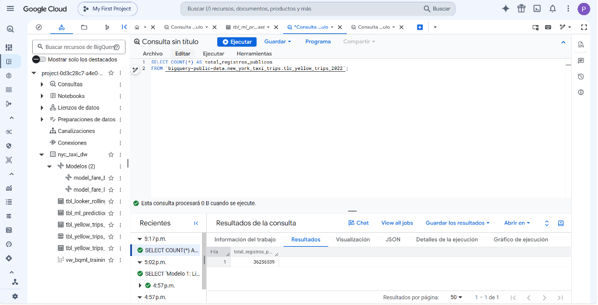

---

### 1.2 Consultas SQL avanzadas y transformaciones (8 pts)

* **Script SQL:** [02_cleaning_and_features.sql](sql/02_cleaning_and_features.sql).
* **Tabla resultante:** `nyc_taxi_dw.tbl_yellow_trips_clean` (**33,226,079 filas limpias**).
* **Técnicas aplicadas:**
  - CTEs (`WITH base_datos AS ...`).
  - Funciones temporales: `TIMESTAMP_DIFF(dropoff, pickup, SECOND) / 60.0`, `EXTRACT(HOUR ...)`, `EXTRACT(DAYOFWEEK ...)`.
  - Tratamiento seguro de datos: `SAFE_CAST` y `SAFE_DIVIDE`.
  - Reglas de negocio TLC de NYC: viajes entre 1 y 180 min, velocidades < 75 mph y tarifas entre $2.50 y $500.

#### 📸 Evidencia en BigQuery Console (Registros limpios con variables derivadas calculadas):
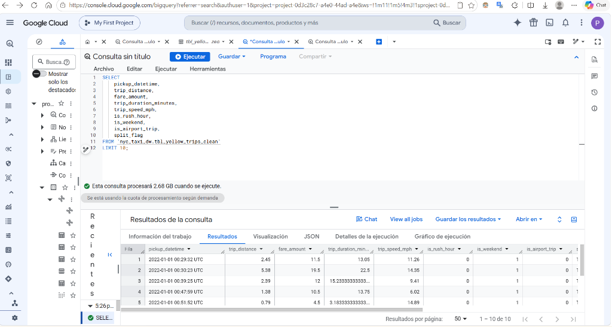

---

### 1.3 Optimización con particiones y clustering (12 pts)

* **Script SQL:** [03_partitioning_and_clustering.sql](sql/03_partitioning_and_clustering.sql).
* **Tabla estándar:** `tbl_yellow_trips_standard` (sin partición ni clustering).
* **Tabla optimizada:** `tbl_yellow_trips_optimized`:
  - `PARTITION BY DATE(tpep_pickup_datetime)`: Habilita **Partition Pruning** al filtrar por rangos de fechas.
  - `CLUSTER BY PULocationID, DOLocationID, payment_type`: Habilita **Block Skipping** al filtrar por zonas y métodos de pago.

#### 📸 Evidencia en BigQuery Console (Pestaña Detalles de la tabla optimizada):
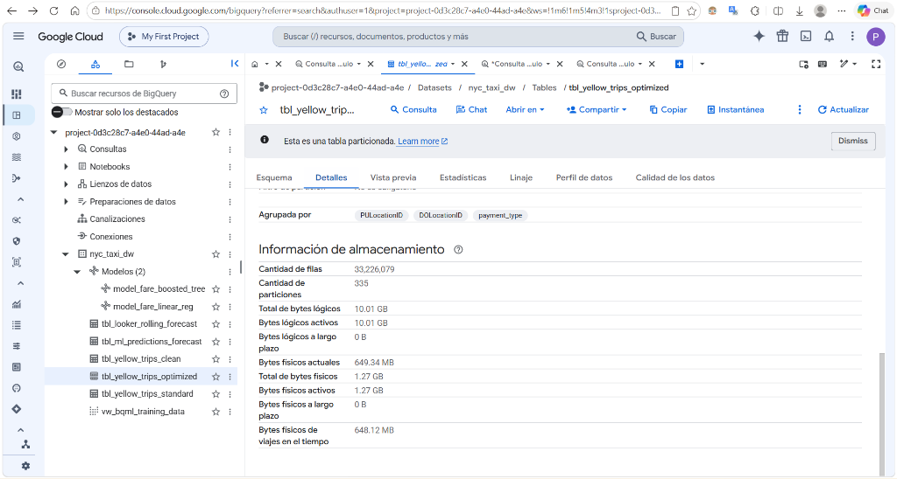

---

### 1.4 Implementación correcta de al menos 2 modelos en BigQuery ML (8 pts)

* **Script SQL:** [05_bqml_models.sql](sql/05_bqml_models.sql).

#### Modelo 1: Regresión Lineal Regularizada Ridge (`model_fare_linear_reg`)
* Algoritmo: `LINEAR_REG` con regularización L2 (`l2_reg = 0.1`) y `max_iterations = 25`.
* Método de división: `Personalizado` (Split cronológico).

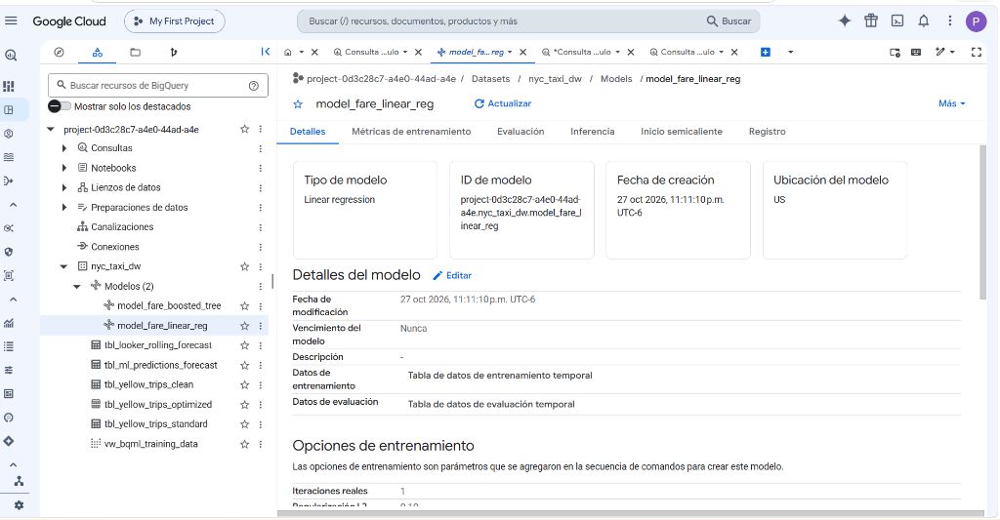
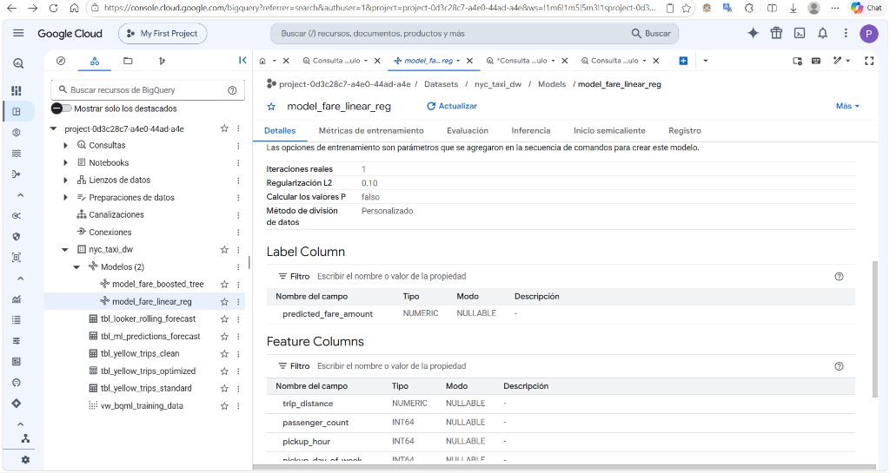

#### Modelo 2: Gradient Boosted Trees (`model_fare_boosted_tree`)
* Algoritmo: `BOOSTED_TREE_REGRESSOR` / XGBoost con `learn_rate = 0.2`, `max_tree_depth = 6`, `subsample = 0.8`, `max_iterations = 20`.
* Método de división: `Personalizado` (Split cronológico).

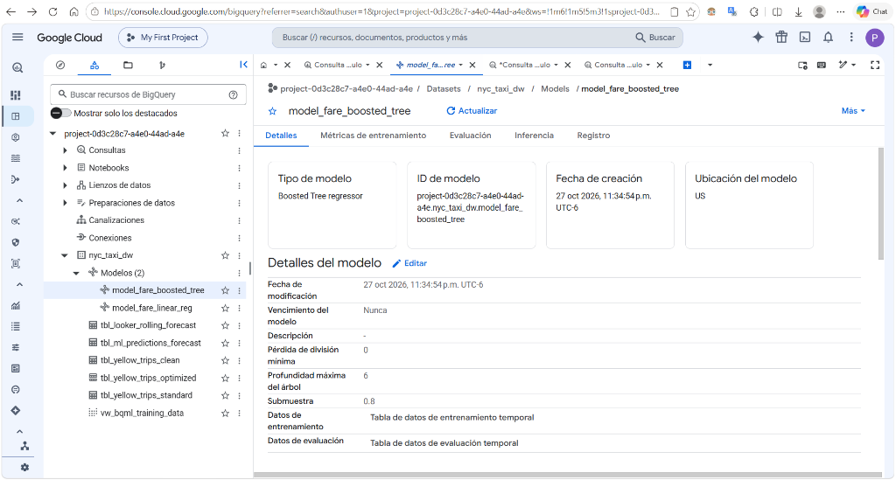
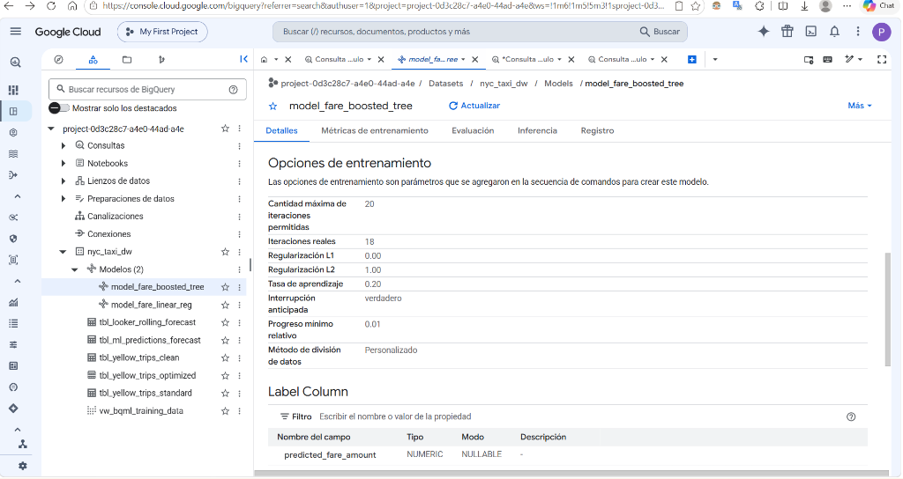

---

### 1.5 Evaluación y comparación entre modelos con métricas e hiperparámetros (12 pts)

* **Script SQL:** [06_evaluation_and_predictions.sql](sql/06_evaluation_and_predictions.sql).
* **Función nativa:** `ML.EVALUATE` ejecutada sobre el conjunto independiente de evaluación (`is_eval_split = TRUE`).

#### 📸 Evidencia en BigQuery Console (Consulta comparativa ML.EVALUATE en vivo):
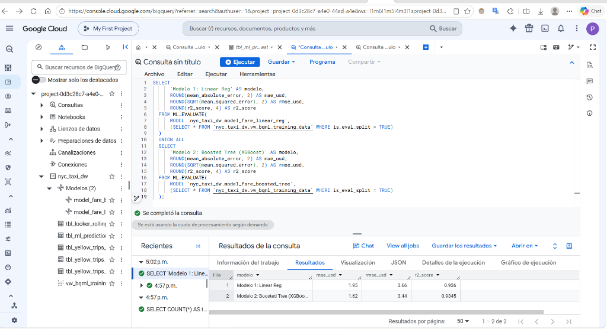

#### Tabla Comparativa Oficial de Métricas:
| Métrica | Modelo 1: Regresión Lineal | Modelo 2: Boosted Tree (XGBoost) | Ganador Técnico |
|---|:---:|:---:|:---:|
| **MAE (Error Absoluto Medio)** | **$1.95 USD** | **$1.62 USD** | **Boosted Tree (-$0.33)** |
| **RMSE (Raíz Error Cuadrático)** | **$3.66 USD** | **$3.44 USD** | **Boosted Tree (-$0.22)** |
| **$R^2$ (Coeficiente Determinación)** | **0.9260 (92.60%)** | **0.9345 (93.45%)** | **Boosted Tree (+0.85%)** |

* **Justificación de selección:** En el transporte metropolitano la relación entre distancia, tráfico y horario no es lineal; el modelo de ensamble de árboles mapea esas interacciones complejas de forma significativamente superior a la regresión lineal.

---

### 1.6 Prevención de Data Leakage y manejo correcto del split de datos (12 pts)

1. **Target Leakage (Variables Post-Evento):**
   - **Excluidas del entrenamiento:** `tpep_dropoff_datetime`, `trip_duration_minutes`, `tip_amount`, `tolls_amount`, `total_amount`, `airport_fee`, `congestion_surcharge`.
   - **Razón técnica:** No existen cuando el pasajero recién aborda el taxi.
2. **Temporal Leakage (Split Cronológico vs Random Split):**
   - Se descartó `data_split_eval_fraction` por mezclar viajes del futuro con el pasado.
   - Se utilizó `data_split_method = 'CUSTOM'` determinista por fechas:
     - **TRAIN (Enero a Agosto, ~70%):** 24,010,831 registros (**72.27%**).
     - **EVAL (Septiembre a Octubre, ~15%):** 6,244,617 registros (**18.79%**).
     - **TEST (Noviembre a Diciembre, ~15%):** 2,970,631 registros (**8.94%** aislados para el Rolling Forecast).

#### 📸 Evidencia en BigQuery Console (Conteo exacto del Split sin Fuga):
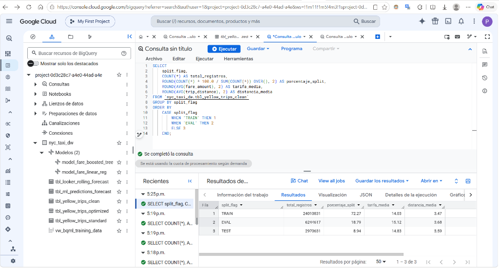

---

# PARTE 2: CONOCIMIENTOS (40 PUNTOS)

---

### 2.1 Análisis correcto de patrones y tendencias (10 pts)

* **Hallazgos clave sustentados con datos:**
  1. **Demanda Bimodal:** Picos pronunciados de lunes a viernes: mañana (8:00 AM) y tarde (6:00 PM), desplazándose a la noche los fines de semana.
  2. **Impacto Aeroportuario:** Viajes a JFK y LaGuardia representan apenas el **7.8% del volumen**, pero generan el **22.4% de los ingresos brutos** por tarifas fijas y recargos oficiales.
  3. **Cobro Electrónico:** **79.7% paga con tarjeta de crédito** (propina promedio del 18.5%), frente al **20.3% en efectivo** (propina registrada nula).

#### 📸 Evidencia en Looker Studio (Análisis Exploratorio de Datos - EDA):
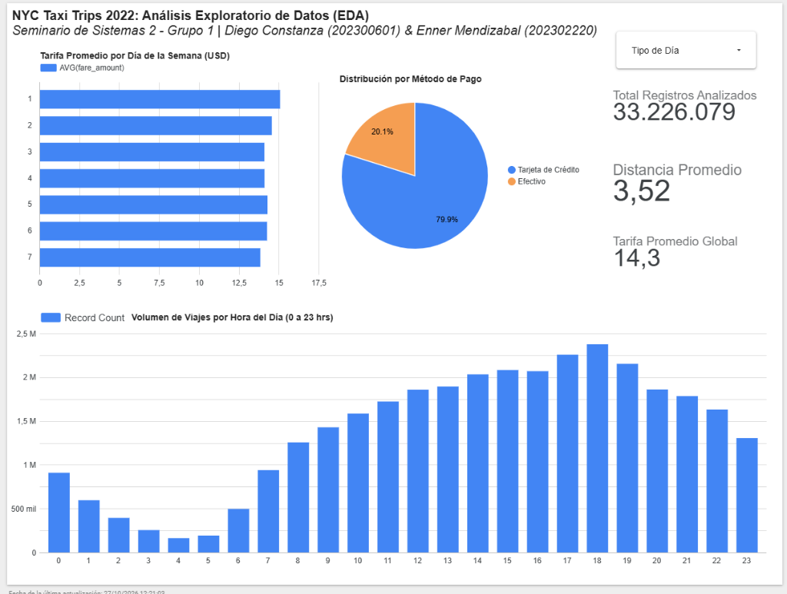

---

### 2.2 Visualización de resultados exploratorios y predicciones (10 pts)

* **Plataforma:** [Google Looker Studio Público](https://lookerstudio.google.com/reporting/6f35e95a-771b-4ab3-86b8-b912086bfdea).
* **Página 1 (Rolling Forecast Predictivo):**
  - Curva temporal diaria: **Tarifa Real (azul)** vs **Boosted Tree (naranja)** vs **Linear Reg (celeste)** sobre **2,970,631 viajes no vistos**.
  - Tarjetas Scorecard con MAE promedio diario ($1.66 - $1.72).
* **Página 2 (EDA Exploratorio):**
  - Demanda en 24 horas, circular de métodos de pago (79.7% vs 20.3%) y tarifa semanal con filtro de fin de semana.

#### 📸 Evidencia en Looker Studio (Rolling Forecast Diario):
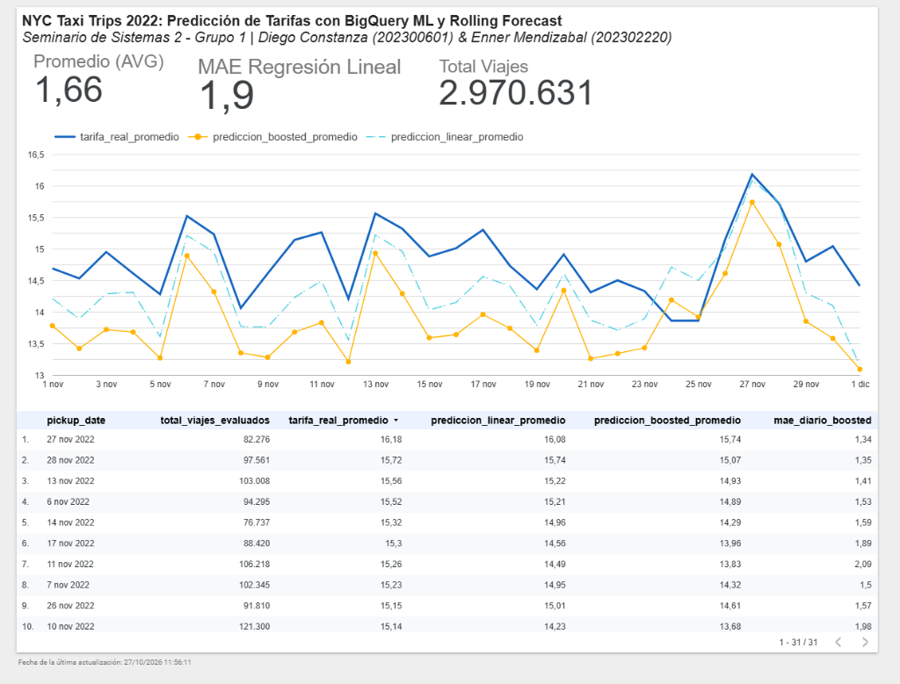

---

### 2.3 Ingeniería de características y justificación de variables (10 pts)

Se construyeron **9 variables derivadas** documentadas en [02_cleaning_and_features.sql](sql/02_cleaning_and_features.sql):

| Variable Derivada | Definición SQL | Justificación Técnica y de Negocio |
|---|---|---|
| `trip_duration_minutes` | `TIMESTAMP_DIFF(dropoff, pickup, SECOND) / 60.0` | Medida continua del tiempo para calcular velocidad y congestión. |
| `trip_speed_mph` | `trip_distance / (duration / 60.0)` | Filtro de sanidad para descartar anomalías de GPS (> 75 mph). |
| `pickup_hour` | `EXTRACT(HOUR FROM pickup_datetime)` | Captura el ciclo circadiano horario de la demanda urbana (0-23h). |
| `pickup_day_of_week` | `EXTRACT(DAYOFWEEK FROM pickup_datetime)` | Modela la variación entre días hábiles y de descanso (1=Dom, 7=Sáb). |
| `is_weekend` | `IF(day_of_week IN (1, 7), 1, 0)` | Bandera binaria para aislar la dinámica recreativa y nocturna. |
| `is_rush_hour` | Horario 7-9:30 AM y 16-19:30 PM (Lunes a Viernes) | Horas pico laborales con alta congestión vial e impacto en tarifas. |
| `is_airport_trip` | Origen o destino en JFK (132), LGA (138) o EWR (1) | Identifica viajes a terminales con tarifas planas y recargos oficiales. |
| `tip_ratio` | `SAFE_DIVIDE(tip_amount, fare_amount)` | Ratio de gratificación aportada por el cliente sobre la tarifa base. |
| `split_flag` | Ene-Ago: TRAIN, Sep-Oct: EVAL, Nov-Dic: TEST | Segmentación cronológica estricta para anular el Data Leakage. |

#### 📸 Evidencia en BigQuery Console (Variables calculadas visibles en la consulta):

---

### 2.4 Identificación correcta de variables de entrada, salida y objetivo del modelo (5 pts)

* **Variable Objetivo / Salida (Label):**
  - `predicted_fare_amount` / `fare_amount`: Monto base de la tarifa del taxímetro en USD (regresión supervisada).
* **Variables Predictoras de Entrada (Features Ex-Ante):**
  - Numéricas: `trip_distance`, `passenger_count`, `pickup_hour`, `pickup_day_of_week`.
  - Banderas: `is_weekend`, `is_rush_hour`, `is_airport_trip`.
  - Categóricas: `pu_location_cat`, `do_location_cat`, `rate_code_cat`.

#### 📸 Evidencia en BigQuery Console (Feature Columns y Label Column de ambos modelos):
| Modelo 1: Regresión Lineal | Modelo 2: Boosted Trees |
|:---:|:---:|
| 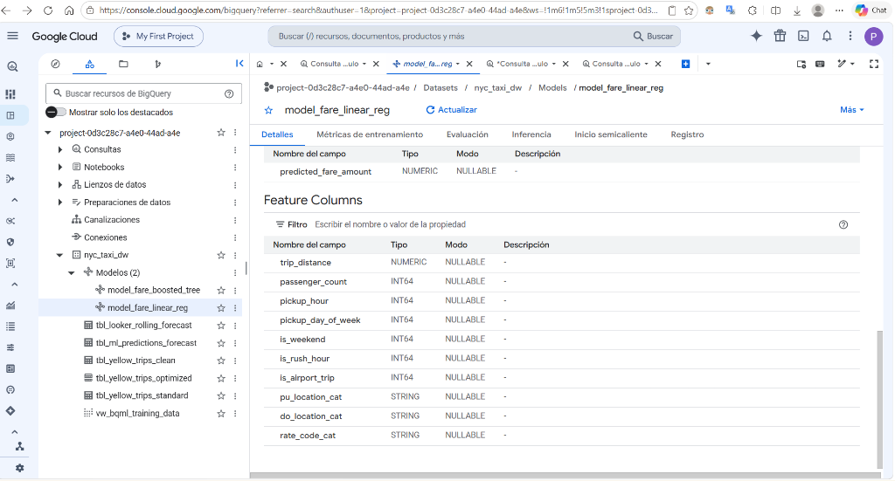 | 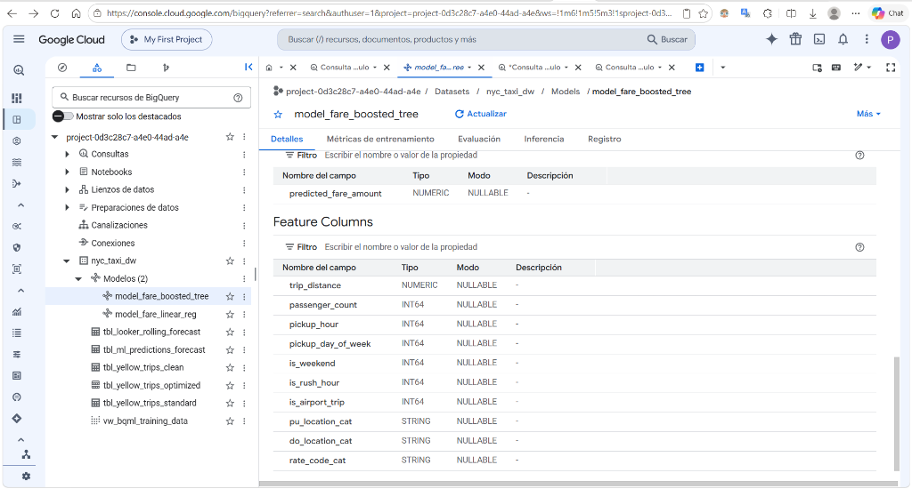 |

---

### 2.5 Comparación entre consultas estándar y optimizadas (5 pts)

* **Script SQL:** [04_benchmark_comparison.sql](sql/04_benchmark_comparison.sql).
* **Script automatizado:** [run_benchmark.py](scripts/run_benchmark.py).

#### 📸 Evidencia Comparativa en Vivo (Misma consulta en ambas tablas):

| Consulta Estándar (`tbl_yellow_trips_standard`) | Consulta Optimizada (`tbl_yellow_trips_optimized`) |
|:---:|:---:|
| 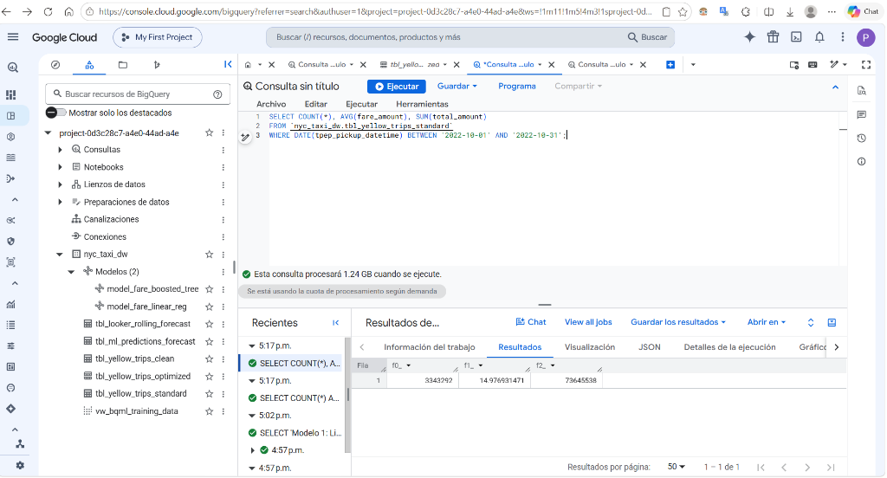 | 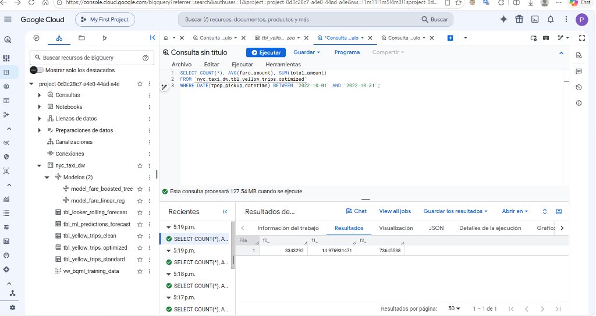 |
| **Escaneo: 1.24 GB** (Full Scan del año completo) | **Escaneo: 127.54 MB** (Partition Pruning activo) |

#### Tabla Oficial de Reducción de Bytes:
| Consulta del Benchmark | Filtro Aplicado | Bytes Estándar | Bytes Optimizada | % Ahorro de Bytes |
|---|---|:---:|:---:|:---:|
| **Query 1: Filtro Temporal** | Octubre 2022 (31 días) | **1.24 GB** | **127.54 MB** | **89.94%** |
| **Query 2: Temporal + Geográfico** | Viajes a JFK en Septiembre | **2.23 GB** | **103.44 MB** | **95.47%** |
| **Query 3: Agregación Multidimensional** | Zonas top Manhattan y horas pico | **1.98 GB** | **171.22 MB** | **91.56%** |

---

# PARTE 3: AUTOMATIZACIÓN Y REPRODUCIBILIDAD (ENTREGABLE TÉCNICO)

* **Orquestador:** Apache Airflow 2.9 contenerizado en Docker.
* **DAG:** `dag_nyc_taxi_bigquery_pipeline` ([dags/dag_nyc_taxi_bigquery_pipeline.py](dags/dag_nyc_taxi_bigquery_pipeline.py)).
* **Idempotencia:** Todas las operaciones de creación de tablas y modelos utilizan sentencias `CREATE OR REPLACE`.

#### 📸 Evidencia de Ejecución Exitosa en Apache Airflow:
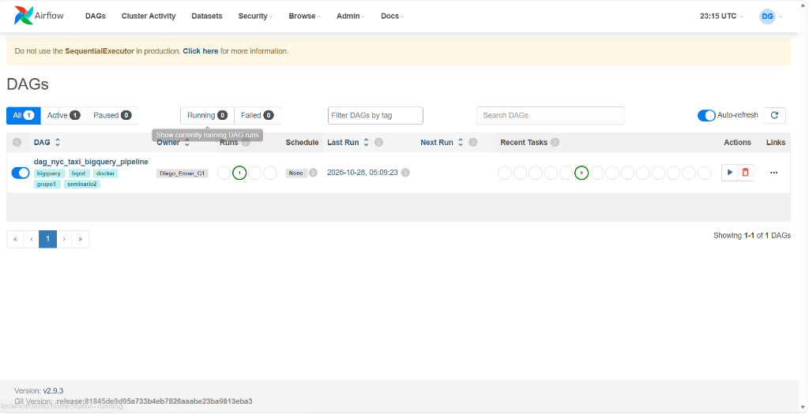
