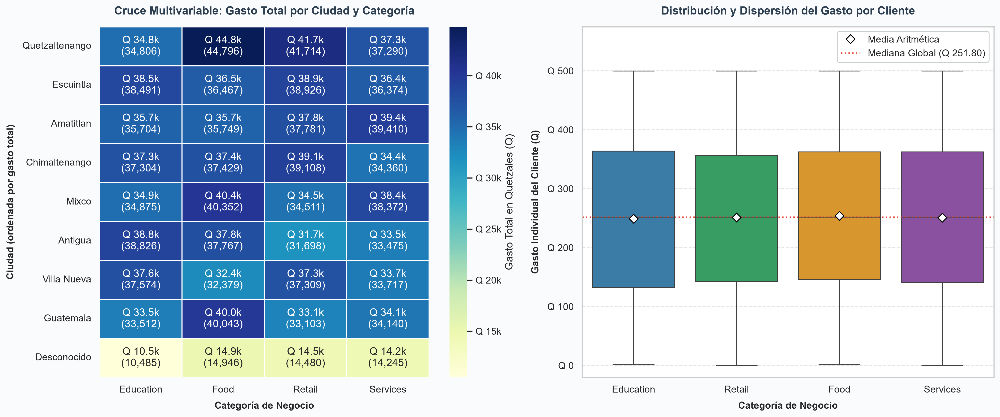

# Tarea 1 — Limpieza y análisis inicial de datos

> Seminario de Sistemas 2 · Grupo 1 · `SS22S2026_G1`  
> Diego Alessandro Constanza Padilla — 202300601  
> Enner Esaí Mendizabal Castro — 202302220

## Tabla de contenidos

1. [Dataset utilizado](#1-dataset-utilizado)
2. [Cómo ejecutar el script](#2-cómo-ejecutar-el-script)
3. [Registro de evidencias y capturas](#3-registro-de-evidencias-y-capturas)
4. [Proceso de limpieza](#4-proceso-de-limpieza)
5. [Antes vs después](#5-antes-vs-después)
6. [Tablas pivote](#6-tablas-pivote)
7. [Visualizaciones](#7-visualizaciones)
   - [7.1 Gráfico 1: Auditoría de Calidad y Rendimiento por Categoría](#71-gráfico-1-auditoría-de-calidad-y-rendimiento-por-categoría)
   - [7.2 Gráfico 2: Estructura Demográfica y Distribución Geográfica](#72-gráfico-2-estructura-demográfica-y-distribución-geográfica)
   - [7.3 Gráfico 3: Cruce Multivariable y Dispersión del Gasto](#73-gráfico-3-cruce-multivariable-ciudad--categoría-y-dispersión-del-gasto)
8. [Interpretación de resultados](#8-interpretación-de-resultados)
9. [Estructura de la carpeta](#9-estructura-de-la-carpeta)

---

## 1. Dataset utilizado

| Campo | Valor |
|---|---|
| Nombre | `dataset_sucio.csv` |
| Ubicación | [`docs/dataset_sucio.csv`](docs/dataset_sucio.csv) |
| Filas originales | 5000 |
| Columnas | `id_cliente`, `nombre`, `genero`, `fecha_registro`, `gasto_q`, `ciudad`, `categoria` |
| Dominio | Clientes y gasto en quetzales (Q) por ciudad y categoría |

El CSV llega con problemas de calidad típicos: duplicados, nulos, `NA`, fechas en dos formatos, gasto con coma o punto decimal, y categorías/ciudades/género en mayúsculas mezcladas.

El resultado depurado se exporta a [`data/dataset_limpio.csv`](data/dataset_limpio.csv).

---

## 2. Cómo ejecutar el script

Desde esta carpeta (`Tarea1/`):

```bash
python -m pip install -r requirements.txt
python limpieza.py
```

Eso corre **de verdad** sobre las 5000 filas: Pandas elimina duplicados, trata nulos, estandariza formatos, muestra pivotes, abre gráficos y guarda el CSV limpio.

Si solo quieres regenerar el CSV y todas las figuras de una vez (sin pausas interactivas):

```bash
python limpieza.py --no-pausa
```

---

## 3. Registro de evidencias y capturas

A continuación se detalla la relación de evidencias generadas durante la ejecución del flujo de preparación, limpieza y análisis:

- **Pasos 1 al 6**: Evidencias del estado del DataFrame y transformaciones en consola (carga, deduplicación, imputación de nulos, estandarización y tablas pivote).
- **Pasos 7 al 9**: Visualizaciones analíticas y gráficos estadísticos **generados y guardados automáticamente por el script de Python** en la carpeta `img/` con resolución de 300 DPI.

| Paso | Archivo en `img/` | Origen / Tipo | Descripción |
|---|---|---|---|
| 1. Dataset original | `01_dataframe_original.png` | Captura de terminal | Estado sucio inicial con nulos, duplicados y formatos mixtos |
| 2. Duplicados | `02_duplicados.png` | Captura de terminal | Eliminación de duplicados (5000 → 4900 registros únicos) |
| 3. Celdas vacías | `03_nulos.png` | Captura de terminal | Imputación con mediana en `gasto_q` y tratamiento de `NA` |
| 4. Estandarización | `04_estandarizacion.png` | Captura de terminal | Unificación de categorías, ciudades, fechas ISO y géneros |
| 5. Dataset depurado | `05_dataframe_limpio.png` | Captura de terminal | Resumen comparativo antes vs. después |
| 6. Pivotes | `06_pivote_categoria.png` | Captura de terminal | Tablas pivote de Pandas por categoría, ciudad, género y cruce |
| 7. Calidad & Categoría | `07_grafico_gasto.png` | **Generado con Python** | Auditoría de nulos antes/después y Gasto total por categoría |
| 8. Demografía & Ciudad | `08_grafico_genero.png` | **Generado con Python** | Demografía de género y Ranking de gasto por ciudad |
| 9. Cruce Multivariable | `09_grafico_cruce.png` | **Generado con Python** | Heatmap Ciudad × Categoría y Boxplot de dispersión de gasto |

---

## 4. Proceso de limpieza

### 4.1 Dataset original (estado sucio)

Pandas lee el CSV tal cual. En la carga inicial se observan:

- 5000 filas y 7 columnas; `gasto_q` llega como texto (mezcla `371.80` y `373,33`).
- Nulos detectados al leer: **genero 60**, **gasto_q 505**, **ciudad 157**.
- **100 filas duplicadas exactas** (y 100 `id_cliente` repetidos, que son los mismos duplicados).
- Género con `m` / `M` / `f` / `F` / vacío.
- Categoría con 12 variantes de solo 4 valores reales (`retail`, `RETAIL`, `Food`, etc.).


### 4.2 Eliminación de duplicados

Se eliminan duplicados exactos con `drop_duplicates()`. Resultado: **5000 → 4900 filas** (100 filas quitadas). No quedaron `id_cliente` repetidos adicionales.


### 4.3 Tratamiento de celdas vacías y `NA`

- `gasto_q` se convierte a número (coma decimal → punto). Quedaron **497 nulos** tras el deduplicado; se rellenan con la **mediana Q 251.80**.
- Cadenas vacías, `NA` y equivalentes se tratan como nulo.
- Nulos categóricos se reemplazan por `Desconocido`: **genero 113**, **ciudad 222**. Categoría y nombre no tenían nulos reales.


### 4.4 Estandarización de valores y formatos

| Columna | Regla |
|---|---|
| `nombre` | Trim, espacios dobles y Title Case |
| `genero` | `M` / `F` / `Desconocido` |
| `ciudad` | Title Case; vacíos y `NA` → `Desconocido` |
| `categoria` | `Retail`, `Services`, `Education`, `Food` |
| `fecha_registro` | `YYYY-MM-DD` (acepta ISO y `DD/MM/YYYY`) |
| `gasto_q` | `float` con 2 decimales |

Tras unificar: **F 2406**, **M 2381**, **Desconocido 113**. Fechas cubren **2026-01-01 → 2026-03-01**.


---

## 5. Antes vs después


| Indicador | Antes | Después |
|---|---|---|
| Filas | 5000 | 4900 |
| Duplicados exactos | 100 | 0 |
| Nulos en `gasto_q` | 505 (y texto con coma) | 0 (numérico) |
| Nulos en `genero` | 60 + vacíos | 0 (`Desconocido` donde faltaba) |
| Nulos en `ciudad` | 157 + `NA`/vacíos | 0 (`Desconocido` donde faltaba) |
| Categorías distintas | 12 variantes | 4 valores canónicos |
| Formato de fecha | ISO y `DD/MM/YYYY` | `YYYY-MM-DD` |

El dataset depurado ya sirve para agregar gasto, armar pivotes y graficar. El CSV exportado está en [`data/dataset_limpio.csv`](data/dataset_limpio.csv).

---

## 6. Tablas pivote

Se usó `pandas.pivot_table` sobre el DataFrame **después** de limpiar. El DataFrame **antes** queda documentado en el paso 1 y 5.


### Gasto por categoría

| categoria | clientes | gasto_total_q | gasto_promedio_q |
|---|---:|---:|---:|
| Education | 1211 | 301,578.86 | 249.03 |
| Food | 1259 | 319,926.29 | 254.11 |
| Retail | 1229 | 308,629.24 | 251.12 |
| Services | 1201 | 301,381.54 | 250.94 |
| **Total** | **4900** | **1,231,515.93** | **251.33** |

Food concentra el mayor gasto total; las cuatro categorías están bastante equilibradas en volumen de clientes.

### Gasto por género

| genero | clientes | gasto_total_q | gasto_promedio_q |
|---|---:|---:|---:|
| F | 2406 | 595,887.58 | 247.67 |
| M | 2381 | 607,320.96 | 255.07 |
| Desconocido | 113 | 28,307.39 | 250.51 |
| **Total** | **4900** | **1,231,515.93** | **251.33** |

Hombres y mujeres están casi a la par en cantidad; el gasto promedio de M es un poco mayor (Q 255 vs Q 248).

### Gasto por ciudad (lectura)

Quetzaltenango tiene más clientes (614) y el mayor gasto total (Q 158,604.89). Escuintla tiene el **promedio más alto** (Q 267.36) y Guatemala el más bajo (Q 241.09). Hay 222 filas con ciudad `Desconocido` (calidad incompleta que ya no rompe el análisis).

---

## 7. Visualizaciones

Las visualizaciones fueron diseñadas con **alta resolución (300 DPI)**, formateo monetario en Quetzales (`Q`), etiquetas de datos directas, líneas de referencia estadística y paneles dobles analíticos para explorar las relaciones entre variables.

### 7.1 Gráfico 1: Auditoría de Calidad y Rendimiento por Categoría


- **Panel A (Auditoría de Calidad - Nulos Antes vs. Después)**:
  - Muestra la efectividad del proceso de depuración por cada columna del dataset.
  - En el estado sucio original existían **505 registros nulos en `gasto_q`**, **157 en `ciudad`** y **60 en `genero`** (722 nulos en total).
  - Tras la limpieza y el tratamiento de tokens (`NA`, `null`, vacíos), el **100% de los campos fueron saneados** (0 nulos residuales).
- **Panel B (Rendimiento Financiero por Categoría)**:
  - Presenta el gasto total acumulado en Quetzales, la participación porcentual sobre el total general (`Q 1,231,515.93`), el conteo de clientes y el ticket promedio individual.
  - **Food** lidera en facturación con **Q 319,926.29 (26.0%)** y 1,259 clientes, superando la línea de promedio global por categoría (**Q 307,878.98**).
  - **Retail** ocupa el segundo lugar con **Q 308,629.24 (25.1%)**, seguido de **Education (Q 301,578.86 / 24.5%)** y **Services (Q 301,381.54 / 24.5%)**.

---

### 7.2 Gráfico 2: Estructura Demográfica y Distribución Geográfica


- **Panel A (Demografía de Clientes y Gasto por Género)**:
  - **Mujeres (F)**: Representan el **49.1%** de la base (2,406 clientes) con un gasto acumulado de **Q 595,887.58** y un ticket medio de **Q 247.67**.
  - **Hombres (M)**: Representan el **48.6%** (2,381 clientes) aportando **Q 607,320.96** con un ticket medio superior de **Q 255.07**.
  - **Desconocido**: 113 clientes (**2.3%**) con un gasto de **Q 28,307.39** (ticket medio Q 250.51), manteniendo la transparencia de los datos sin sesgar las categorías binarias.
- **Panel B (Distribución Geográfica de Gasto por Ciudad)**:
  - Ranking horizontal ordenado de facturación total contra la línea de media por ciudad (**Q 136,835.10**).
  - **Quetzaltenango** es el mercado principal con **Q 158,604.89** y 614 clientes (Ticket: Q 258.31).
  - **Escuintla** tiene el mayor ticket promedio por cliente (**Q 267.36**), totalizando **Q 150,258.21** con 562 clientes.
  - Las ciudades de Amatitlán, Chimaltenango, Mixco, Antigua, Villa Nueva y Guatemala se mantienen consistentemente por encima de los Q 140,000.

---

### 7.3 Gráfico 3: Cruce Multivariable (Ciudad × Categoría) y Dispersión del Gasto



- **Panel A (Matriz de Calor - Cruce Ciudad × Categoría)**:
  - Visualización integral de la **Tabla Pivote 4**, reflejando la intensidad de facturación en Quetzales para cada combinación geográfica y comercial.
  - Los nodos de mayor concentración de ventas se localizan en **Quetzaltenango × Food (Q 44.8k)**, **Quetzaltenango × Retail (Q 41.7k)**, **Mixco × Food (Q 40.4k)** y **Guatemala × Food (Q 40.0k)**.
  - Evidencia que el rubro *Food* es transversalmente el motor de gasto en los principales núcleos urbanos.
- **Panel B (Distribución y Dispersión del Gasto por Cliente)**:
  - Diagrama de caja y bigotes (*Boxplot*) por categoría con marcadores de **Media Aritmética (rombos blancos)** y **Mediana Global (línea punteada roja Q 251.80)**.
  - Demuestra una distribución uniforme y balanceada del gasto individual entre Q 0.00 y Q 500.00, con un rango intercuartílico simétrico (Q1 ≈ Q 135, Mediana ≈ Q 251.80, Q3 ≈ Q 365) en las 4 categorías, validando la estabilidad estadística del dataset tras la imputación.

---

## 8. Interpretación de resultados

La limpieza **sí cambia la calidad de la información**, no solo el aspecto:

1. **Se puede sumar y analizar el gasto.** Antes `gasto_q` era texto con comas y 505 huecos; ahora es una variable continua limpia con un total de **Q 1,231,515.93**.
2. **Las categorías ya no se fragmentan.** 12 variantes sucias se redujeron a 4 categorías canónicas, permitiendo calcular participación de mercado real sin divisiones artificiales.
3. **Ciudad y género se pueden cruzar y agrupar.** Los valores faltantes se imputaron responsablemente como `Desconocido` (222 en ciudad, 113 en género), garantizando análisis fidedignos sin inflar municipios o géneros arbitrariamente.
4. **Eliminación de 100 duplicados exactos** que inflaban artificialmente los ingresos en más de Q 25,000 y el volumen de usuarios.
5. **Comportamiento multivariable equilibrado**: El cruce geográfico-comercial demuestra solidez en todas las regiones, destacando Quetzaltenango y Escuintla como polos de alta rentabilidad y Food como la categoría de mayor tracción.

---

## 9. Estructura de la carpeta

```
Tarea1/
  limpieza.py                 Script de limpieza y análisis con generación de gráficos
  requirements.txt            pandas, matplotlib, seaborn
  README.md                   Documentación completa y análisis de resultados
  docs/
    state.md                  Enunciado de la tarea y rúbrica
    dataset_sucio.csv         Dataset original (5000 filas)
  data/
    dataset_limpio.csv        Dataset exportado (4900 filas depuradas)
  img/                        Capturas y gráficos generados a 300 DPI
    01_dataframe_original.png
    02_duplicados.png
    03_nulos.png
    04_estandarizacion.png
    05_dataframe_limpio.png
    06_pivote_categoria.png
    07_grafico_gasto.png
    08_grafico_genero.png
    09_grafico_cruce.png
```
