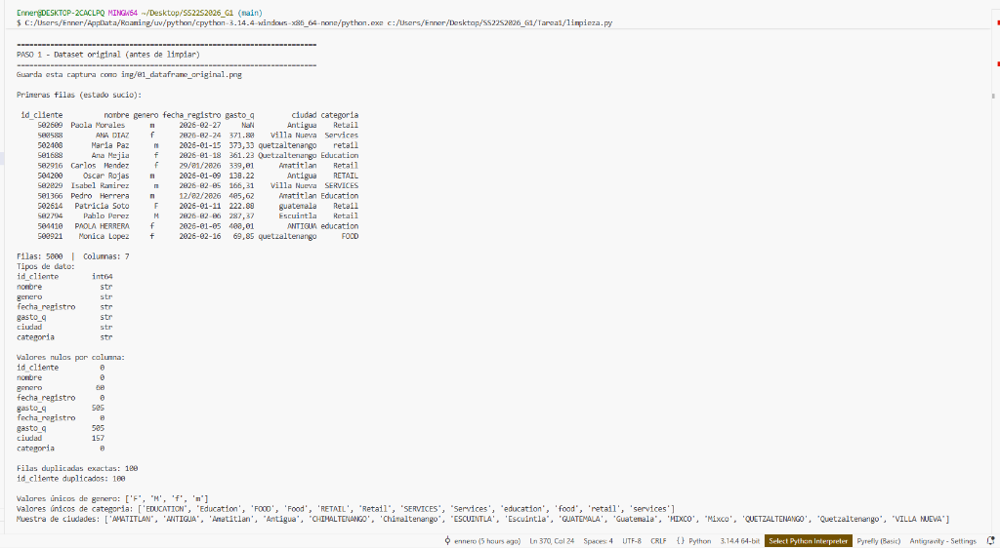
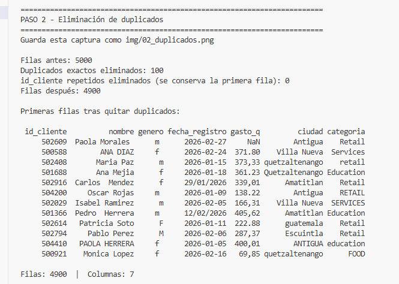
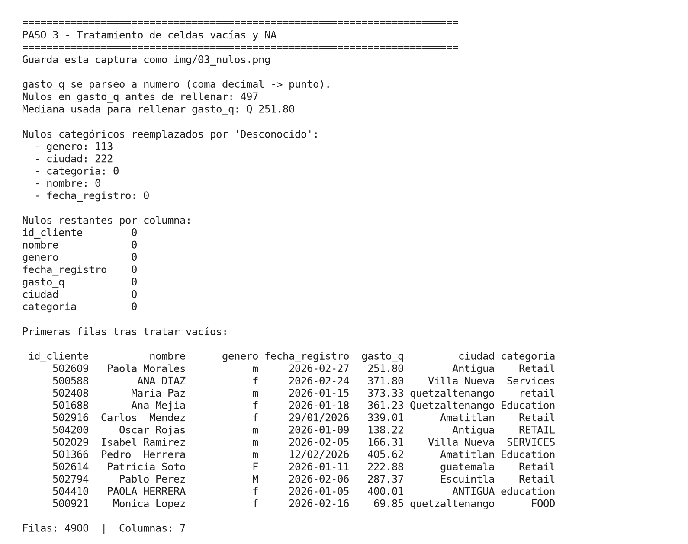
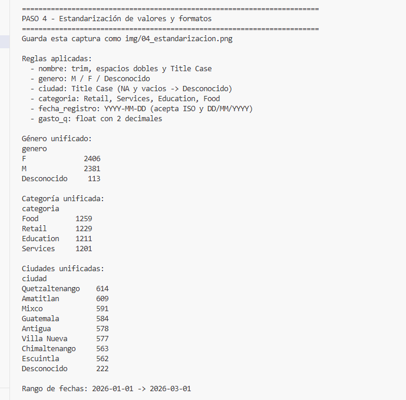
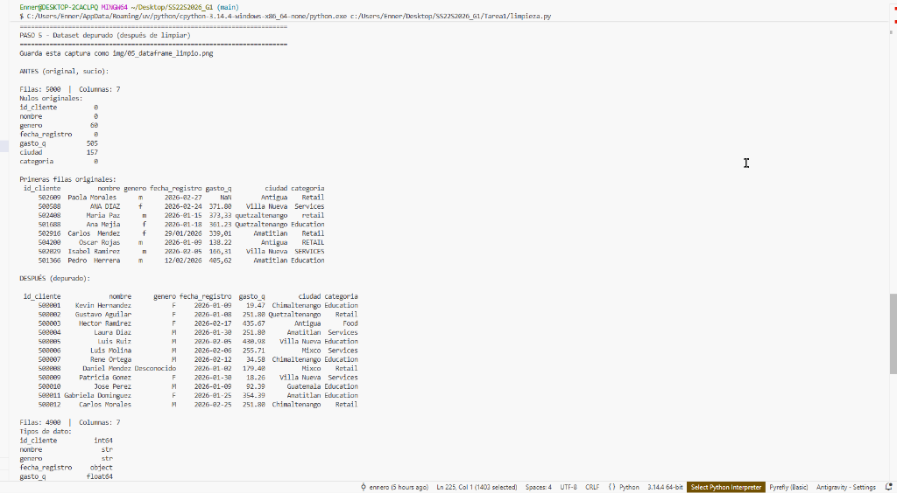
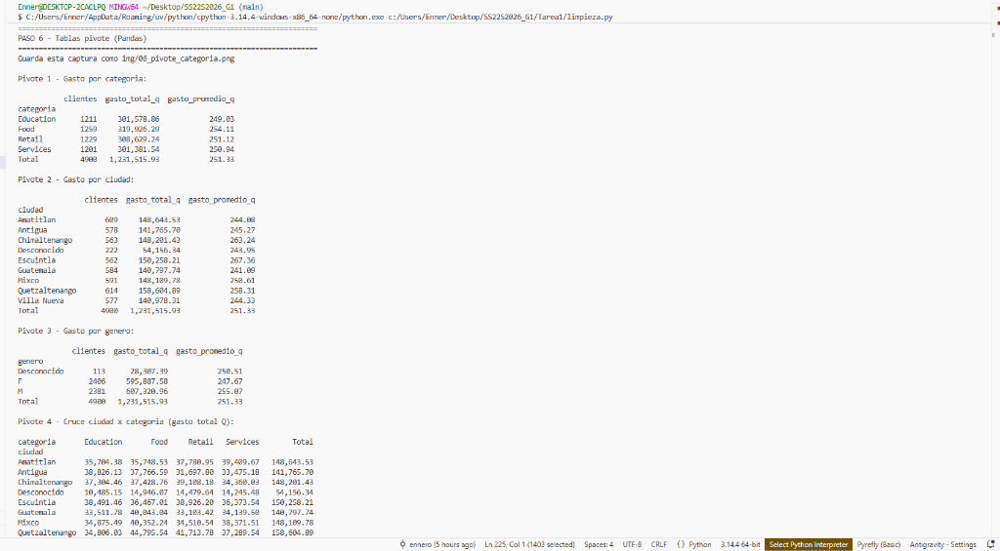
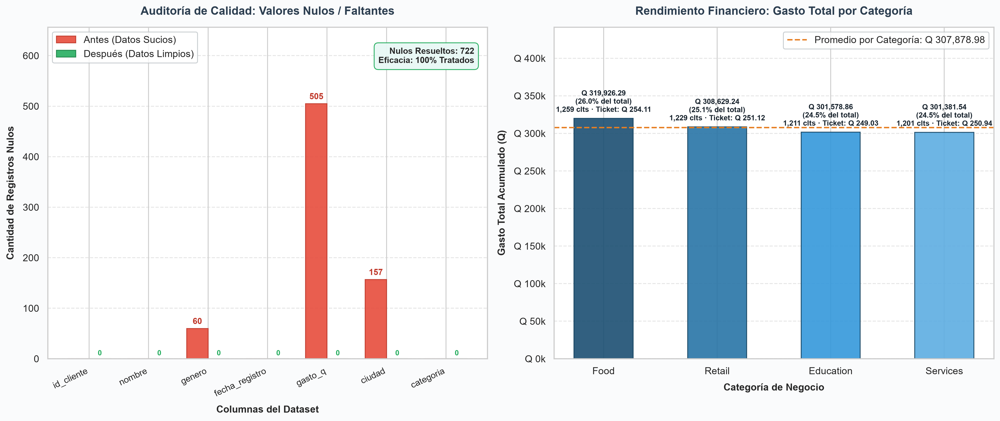
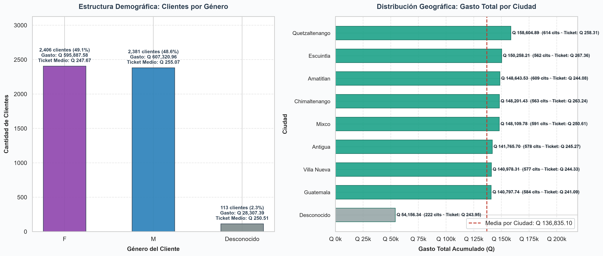

# Tarea 1 — Limpieza y análisis inicial de datos

> Seminario de Sistemas 2 · Grupo 1 · `SS22S2026_G1`  
> Diego Alessandro Constanza Padilla — 202300601  
> Enner Esaí Mendizabal Castro — 202302220

## Tabla de contenidos

1. [Dataset utilizado](#1-dataset-utilizado)
2. [Cómo ejecutar el script](#2-cómo-ejecutar-el-script)
3. [Cómo tomar las capturas](#3-cómo-tomar-las-capturas)
4. [Proceso de limpieza](#4-proceso-de-limpieza)
5. [Antes vs después](#5-antes-vs-después)
6. [Tablas pivote](#6-tablas-pivote)
7. [Visualizaciones](#7-visualizaciones)
8. [Interpretación de resultados](#8-interpretación-de-resultados)
9. [Estructura de la carpeta](#9-estructura-de-la-carpeta)

---

## 1. Dataset utilizado

| Campo | Valor |
|---|---|
| Nombre | `dataset_sucio.csv` |
| Ubicación | [`docs/dataset_sucio.csv`](docs/dataset_sucio.csv) |
| Filas originales | 5000 |
| Columnas | `id_cliente`, `nombre`, `genero`, `fecha_registro`, `gasto_q`, `ciudad`, `categoria` |
| Dominio | Clientes y gasto en quetzales (Q) por ciudad y categoría |

El CSV llega con problemas de calidad típicos: duplicados, nulos, `NA`, fechas en dos formatos, gasto con coma o punto decimal, y categorías/ciudades/género en mayúsculas mezcladas.

El resultado depurado se exporta a [`data/dataset_limpio.csv`](data/dataset_limpio.csv).

---

## 2. Cómo ejecutar el script

Desde esta carpeta (`Tarea1/`):

```bash
python -m pip install -r requirements.txt
python limpieza.py
```

Eso corre **de verdad** sobre las 5000 filas: Pandas elimina duplicados, trata nulos, estandariza formatos, muestra pivotes, abre gráficos y guarda el CSV limpio.

Si solo quieres regenerar el CSV, sin pausas ni ventanas:

```bash
python limpieza.py --no-pausa
```

---

## 3. Cómo tomar las capturas

El script se detiene en cada paso y te dice el nombre del archivo. Flujo:

1. Ejecuta `python limpieza.py`.
2. Cuando veas `>>> Toma la captura y presiona Enter...`, fotografía la terminal (o la ventana del gráfico).
3. Guarda el PNG en `img/` **con el nombre exacto** que imprime el paso.
4. Presiona Enter y sigue.

Cuando el archivo exista en `img/`, GitHub/Markdown lo muestra solo en este README. Mientras tanto, el hueco queda marcado.

| Paso | Archivo a pegar en `img/` |
|---|---|
| 1. Dataset original | `01_dataframe_original.png` |
| 2. Duplicados | `02_duplicados.png` |
| 3. Celdas vacías | `03_nulos.png` |
| 4. Estandarización | `04_estandarizacion.png` |
| 5. Dataset depurado | `05_dataframe_limpio.png` |
| 6. Pivotes | `06_pivote_categoria.png` |
| 7. Gráfico de gasto | `07_grafico_gasto.png` |
| 8. Gráfico de género | `08_grafico_genero.png` |

---

## 4. Proceso de limpieza

### 4.1 Dataset original (estado sucio)

Pandas lee el CSV tal cual. En la carga inicial se observan:

- 5000 filas y 7 columnas; `gasto_q` llega como texto (mezcla `371.80` y `373,33`).
- Nulos detectados al leer: **genero 60**, **gasto_q 505**, **ciudad 157**.
- **100 filas duplicadas exactas** (y 100 `id_cliente` repetidos, que son los mismos duplicados).
- Género con `m` / `M` / `f` / `F` / vacío.
- Categoría con 12 variantes de solo 4 valores reales (`retail`, `RETAIL`, `Food`, etc.).



### 4.2 Eliminación de duplicados

Se eliminan duplicados exactos con `drop_duplicates()`. Resultado: **5000 → 4900 filas** (100 filas quitadas). No quedaron `id_cliente` repetidos adicionales.



### 4.3 Tratamiento de celdas vacías y `NA`

- `gasto_q` se convierte a número (coma decimal → punto). Quedaron **497 nulos** tras el deduplicado; se rellenan con la **mediana Q 251.80**.
- Cadenas vacías, `NA` y equivalentes se tratan como nulo.
- Nulos categóricos se reemplazan por `Desconocido`: **genero 113**, **ciudad 222**. Categoría y nombre no tenían nulos reales.



### 4.4 Estandarización de valores y formatos

| Columna | Regla |
|---|---|
| `nombre` | Trim, espacios dobles y Title Case |
| `genero` | `M` / `F` / `Desconocido` |
| `ciudad` | Title Case; vacíos y `NA` → `Desconocido` |
| `categoria` | `Retail`, `Services`, `Education`, `Food` |
| `fecha_registro` | `YYYY-MM-DD` (acepta ISO y `DD/MM/YYYY`) |
| `gasto_q` | `float` con 2 decimales |

Tras unificar: **F 2406**, **M 2381**, **Desconocido 113**. Fechas cubren **2026-01-01 → 2026-03-01**.



---

## 5. Antes vs después



| Indicador | Antes | Después |
|---|---|---|
| Filas | 5000 | 4900 |
| Duplicados exactos | 100 | 0 |
| Nulos en `gasto_q` | 505 (y texto con coma) | 0 (numérico) |
| Nulos en `genero` | 60 + vacíos | 0 (`Desconocido` donde faltaba) |
| Nulos en `ciudad` | 157 + `NA`/vacíos | 0 (`Desconocido` donde faltaba) |
| Categorías distintas | 12 variantes | 4 valores canónicos |
| Formato de fecha | ISO y `DD/MM/YYYY` | `YYYY-MM-DD` |

El dataset depurado ya sirve para agregar gasto, armar pivotes y graficar. El CSV exportado está en [`data/dataset_limpio.csv`](data/dataset_limpio.csv).

---

## 6. Tablas pivote

Se usó `pandas.pivot_table` sobre el DataFrame **después** de limpiar. El DataFrame **antes** queda documentado en el paso 1 y 5.



### Gasto por categoría

| categoria | clientes | gasto_total_q | gasto_promedio_q |
|---|---:|---:|---:|
| Education | 1211 | 301,578.86 | 249.03 |
| Food | 1259 | 319,926.29 | 254.11 |
| Retail | 1229 | 308,629.24 | 251.12 |
| Services | 1201 | 301,381.54 | 250.94 |
| **Total** | **4900** | **1,231,515.93** | **251.33** |

Food concentra el mayor gasto total; las cuatro categorías están bastante equilibradas en volumen de clientes.

### Gasto por género

| genero | clientes | gasto_total_q | gasto_promedio_q |
|---|---:|---:|---:|
| F | 2406 | 595,887.58 | 247.67 |
| M | 2381 | 607,320.96 | 255.07 |
| Desconocido | 113 | 28,307.39 | 250.51 |
| **Total** | **4900** | **1,231,515.93** | **251.33** |

Hombres y mujeres están casi a la par en cantidad; el gasto promedio de M es un poco mayor (Q 255 vs Q 248).

### Gasto por ciudad (lectura)

Quetzaltenango tiene más clientes (614) y el mayor gasto total (Q 158,604.89). Escuintla tiene el **promedio más alto** (Q 267.36) y Guatemala el más bajo (Q 241.09). Hay 222 filas con ciudad `Desconocido` (calidad incompleta que ya no rompe el análisis).

---

## 7. Visualizaciones

El script abre dos ventanas: nulos antes/después + gasto por categoría; y distribución por género + gasto por ciudad.





---

## 8. Interpretación de resultados

La limpieza **sí cambia la calidad de la información**, no solo el aspecto:

1. **Se puede sumar el gasto.** Antes `gasto_q` era texto con comas y 505 huecos; ahora es número y el total del período es **Q 1,231,515.93**.
2. **Las categorías ya no se fragmentan.** 12 etiquetas distintas se redujeron a 4, así que un pivote por categoría deja de contar `retail` y `RETAIL` como negocios distintos.
3. **Ciudad y género se pueden agrupar.** Los vacíos no se silenciaron: quedaron como `Desconocido` (222 ciudades, 113 géneros), lo que hace visible el faltante en lugar de inflar otra ciudad o un género.
4. **100 filas duplicadas** no debían entrar a ningún indicador; quitarlas evita inflar clientes y gasto.
5. A nivel de negocio, el gasto está repartido de forma parecida entre categorías y ciudades; no hay un único segmento que domine. Food y Quetzaltenango lideran en total; Escuintla en ticket promedio.

Eso cubre el criterio de la rúbrica: se ve el DataFrame sucio, el depurado, y el impacto en la calidad.

---

## 9. Estructura de la carpeta

```
Tarea1/
  limpieza.py                 Script de limpieza y análisis
  requirements.txt            pandas, matplotlib, seaborn
  README.md                   Este archivo
  docs/
    state.md                  Enunciado de la tarea
    dataset_sucio.csv         Dataset original
  data/
    dataset_limpio.csv        Dataset exportado (depurado)
  img/                        Capturas (pegar aquí los PNG)
```
